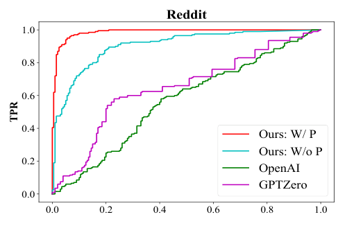

# academic-figure-skill

A Claude Code skill for academic paper figures made with matplotlib or seaborn: sized to the venue's column width, print typography, color-blind-safe colors, value labels where the paper makes its claim, and a paper-style caption, delivered as cells in a `figures/figures.ipynb` notebook in your project.

## Design

How figures look is defined in [`DESIGN.md`](skills/academic-figure/assets/DESIGN.md), in the [DESIGN.md](https://github.com/google-labs-code/design.md) format: tokens (colors, type sizes, spacing, line widths) in its front matter, then Overview, Colors, Typography, Layout, Shapes, Components (the chart types) and Do's and Don'ts. The skill copies it into your project's `figures/`, and `paper.use_design()` reads its tokens to set matplotlib's style, so editing `figures/DESIGN.md` restyles every figure of that paper. [`SKILL.md`](skills/academic-figure/SKILL.md) is the workflow: takeaway, chart type, notebook, caption and checks.

## Examples

Every example shows the same figure drawn by Claude Code subagents with a clean context, without any skill and following this skill, from the same data and task, for an ICLR paper. Figures are shown at their printed size (1 in = 96 px), so at 100% browser zoom they appear as on the page; click a figure to open it full size.

Each group in [`examples/`](examples) holds `data/` (the input), `tasks/` (the request the subagent got), `notebooks/` (the code written with the skill, runnable in place), `outputs/` (the figures with the skill) and `without-skill/` (the same tasks drawn without it); use cases also hold `originals/` (the papers' figures).

### 1. Chart types

The basic chart types of matplotlib and seaborn, one realistic experiment each. The data is synthetic, made to look like a real experiment.

<table>
<tr><th>Without skill</th><th>With skill</th></tr>
<tr><td colspan="2"><b>Example 1.1</b> · Line chart: Learning curve, mean ± std over 5 seeds. Guidelines: <a href="skills/academic-figure/line-chart.md"><code>line-chart.md</code></a></td></tr>
<tr><td valign="top"><a href="examples/chart-types/without-skill/learning-curve.png"></a></td><td valign="top"><a href="examples/chart-types/outputs/learning-curve.png"></a></td></tr>
<tr><td colspan="2"><b>Example 1.2</b> · Bar chart: Grouped bar chart, methods × benchmarks. Guidelines: <a href="skills/academic-figure/bar-chart.md"><code>bar-chart.md</code></a></td></tr>
<tr><td valign="top"><a href="examples/chart-types/without-skill/grouped-bar-chart.png"></a></td><td valign="top"><a href="examples/chart-types/outputs/grouped-bar-chart.png"></a></td></tr>
<tr><td colspan="2"><b>Example 1.3</b> · Scatter plot: Reward score against human rating, per response. Guidelines: <a href="skills/academic-figure/scatter-plot.md"><code>scatter-plot.md</code></a></td></tr>
<tr><td valign="top"><a href="examples/chart-types/without-skill/correlation.png"></a></td><td valign="top"><a href="examples/chart-types/outputs/correlation.png"></a></td></tr>
<tr><td colspan="2"><b>Example 1.4</b> · Box plot: Grouped box plot of response lengths. Guidelines: <a href="skills/academic-figure/box-plot.md"><code>box-plot.md</code></a></td></tr>
<tr><td valign="top"><a href="examples/chart-types/without-skill/grouped-box-plot.png"></a></td><td valign="top"><a href="examples/chart-types/outputs/grouped-box-plot.png"></a></td></tr>
<tr><td colspan="2"><b>Example 1.5</b> · Heatmap: Accuracy over a hyperparameter grid. Guidelines: <a href="skills/academic-figure/heatmap.md"><code>heatmap.md</code></a></td></tr>
<tr><td valign="top"><a href="examples/chart-types/without-skill/hyperparameter-grid.png"></a></td><td valign="top"><a href="examples/chart-types/outputs/hyperparameter-grid.png"></a></td></tr>
<tr><td colspan="2"><b>Example 1.6</b> · Histogram: Overlaid histograms of confidence. Guidelines: <a href="skills/academic-figure/histogram.md"><code>histogram.md</code></a></td></tr>
<tr><td valign="top"><a href="examples/chart-types/without-skill/confidence-histogram.png"></a></td><td valign="top"><a href="examples/chart-types/outputs/confidence-histogram.png"></a></td></tr>
<tr><td colspan="2"><b>Example 1.7</b> · Error bar plot: Means over seeds with ±1 std. Guidelines: <a href="skills/academic-figure/error-bar-plot.md"><code>error-bar-plot.md</code></a></td></tr>
<tr><td valign="top"><a href="examples/chart-types/without-skill/error-bar-plot.png"></a></td><td valign="top"><a href="examples/chart-types/outputs/error-bar-plot.png"></a></td></tr>
<tr><td colspan="2"><b>Example 1.8</b> · Area chart: Stacked area chart of a data curriculum. Guidelines: <a href="skills/academic-figure/area-chart.md"><code>area-chart.md</code></a></td></tr>
<tr><td valign="top"><a href="examples/chart-types/without-skill/data-mixture.png"></a></td><td valign="top"><a href="examples/chart-types/outputs/data-mixture.png"></a></td></tr>
<tr><td colspan="2"><b>Example 1.9</b> · Contour plot: Validation loss over learning rate × weight decay. Guidelines: <a href="skills/academic-figure/contour-plot.md"><code>contour-plot.md</code></a></td></tr>
<tr><td valign="top"><a href="examples/chart-types/without-skill/hyperparameter-surface.png"></a></td><td valign="top"><a href="examples/chart-types/outputs/hyperparameter-surface.png"></a></td></tr>
<tr><td colspan="2"><b>Example 1.10</b> · Radar chart: Benchmark profiles of three models. Guidelines: <a href="skills/academic-figure/radar-chart.md"><code>radar-chart.md</code></a></td></tr>
<tr><td valign="top"><a href="examples/chart-types/without-skill/radar-chart.png"></a></td><td valign="top"><a href="examples/chart-types/outputs/radar-chart.png"></a></td></tr>
<tr><td colspan="2"><b>Example 1.11</b> · Pie chart: Donut chart of a dataset's composition. Guidelines: <a href="skills/academic-figure/pie-chart.md"><code>pie-chart.md</code></a></td></tr>
<tr><td valign="top"><a href="examples/chart-types/without-skill/dataset-composition.png"></a></td><td valign="top"><a href="examples/chart-types/outputs/dataset-composition.png"></a></td></tr>
<tr><td colspan="2"><b>Example 1.12</b> · Violin plot: Bimodal reward distributions. Guidelines: <a href="skills/academic-figure/violin-plot.md"><code>violin-plot.md</code></a></td></tr>
<tr><td valign="top"><a href="examples/chart-types/without-skill/reward-distribution.png"></a></td><td valign="top"><a href="examples/chart-types/outputs/reward-distribution.png"></a></td></tr>
</table>

### 2. Use cases from ML papers

Figures from published papers, redrawn without any skill and following this skill (2.1–2.5, from the figures' data read from the papers' vector paths), then plots that recur across ML papers, each redrawn from a published figure with the paper's own values, recovered from the PDF (2.6–2.14), next to the original.

<table>
<tr><th>Without skill</th><th>With skill</th></tr>
<tr><td colspan="2"><b>Example 2.1</b> · Line chart: DAPO, Figure 2 (left panel, single column). <a href="https://arxiv.org/abs/2503.14476">DAPO: An Open-Source LLM Reinforcement Learning System at Scale</a> (Yu et al., 2025)</td></tr>
<tr><td valign="top"><a href="examples/use-cases/without-skill/dapo-fig2.png"></a></td><td valign="top"><a href="examples/use-cases/outputs/dapo-fig2.png"></a></td></tr>
<tr><td colspan="2"><b>Example 2.2</b> · Line chart: DAPO, Figure 6 (1.5 column). <a href="https://arxiv.org/abs/2503.14476">DAPO: An Open-Source LLM Reinforcement Learning System at Scale</a> (Yu et al., 2025)</td></tr>
<tr><td valign="top"><a href="examples/use-cases/without-skill/dapo-fig6.png"></a></td><td valign="top"><a href="examples/use-cases/outputs/dapo-fig6.png"></a></td></tr>
<tr><td colspan="2"><b>Example 2.3</b> · Line chart: Does RL Really Incentivize Reasoning Capacity?, Figure 2: pass@k grid (double column). <a href="https://arxiv.org/abs/2504.13837">Does Reinforcement Learning Really Incentivize Reasoning Capacity in LLMs Beyond the Base Model?</a> (Yue et al., 2025)</td></tr>
<tr><td valign="top"><a href="examples/use-cases/without-skill/rlvr-fig2.png"></a></td><td valign="top"><a href="examples/use-cases/outputs/rlvr-fig2.png"></a></td></tr>
<tr><td colspan="2"><b>Example 2.4</b> · Histogram: Does RL Really Incentivize Reasoning Capacity?, Figure 5 (single column). <a href="https://arxiv.org/abs/2504.13837">Does Reinforcement Learning Really Incentivize Reasoning Capacity in LLMs Beyond the Base Model?</a> (Yue et al., 2025)</td></tr>
<tr><td valign="top"><a href="examples/use-cases/without-skill/rlvr-fig5.png"></a></td><td valign="top"><a href="examples/use-cases/outputs/rlvr-fig5.png"></a></td></tr>
<tr><td colspan="2"><b>Example 2.5</b> · Box plot: Does RL Really Incentivize Reasoning Capacity?, Figure 6, Problem 1 only (single column). <a href="https://arxiv.org/abs/2504.13837">Does Reinforcement Learning Really Incentivize Reasoning Capacity in LLMs Beyond the Base Model?</a> (Yue et al., 2025)</td></tr>
<tr><td valign="top"><a href="examples/use-cases/without-skill/rlvr-fig6.png"></a></td><td valign="top"><a href="examples/use-cases/outputs/rlvr-fig6.png"></a></td></tr>
</table>

<table>
<tr><th>Original</th><th>Without skill</th><th>With skill</th></tr>
<tr><td colspan="3"><b>Example 2.6</b> · Line chart: ROC curves of AI-text detectors. <a href="https://arxiv.org/abs/2305.17359">Yang et al. (2024), DNA-GPT: Divergent N-Gram Analysis for Training-Free Detection of GPT-Generated Text</a>, Figure 8 (left). Guidelines: <a href="skills/academic-figure/line-chart.md"><code>line-chart.md</code></a></td></tr>
<tr><td valign="top"><a href="examples/use-cases/originals/roc-curve.png"></a></td><td valign="top"><a href="examples/use-cases/without-skill/roc-curve.png"></a></td><td valign="top"><a href="examples/use-cases/outputs/roc-curve.png"></a></td></tr>
<tr><td colspan="3"><b>Example 2.7</b> · Bar chart: Confidence histograms and reliability diagrams. <a href="https://arxiv.org/abs/1706.04599">Guo et al. (2017), On Calibration of Modern Neural Networks</a>, Figure 1. Guidelines: <a href="skills/academic-figure/bar-chart.md"><code>bar-chart.md</code></a></td></tr>
<tr><td valign="top"><a href="examples/use-cases/originals/reliability-diagram.png"></a></td><td valign="top"><a href="examples/use-cases/without-skill/reliability-diagram.png"></a></td><td valign="top"><a href="examples/use-cases/outputs/reliability-diagram.png"></a></td></tr>
<tr><td colspan="3"><b>Example 2.8</b> · Line chart: Scaling law with a power-law fit. <a href="https://arxiv.org/abs/2001.08361">Kaplan et al. (2020), Scaling Laws for Neural Language Models</a>, Figure 1 (right). Guidelines: <a href="skills/academic-figure/line-chart.md"><code>line-chart.md</code></a></td></tr>
<tr><td valign="top"><a href="examples/use-cases/originals/scaling-law.png"></a></td><td valign="top"><a href="examples/use-cases/without-skill/scaling-law.png"></a></td><td valign="top"><a href="examples/use-cases/outputs/scaling-law.png"></a></td></tr>
<tr><td colspan="3"><b>Example 2.9</b> · Scatter plot: Accuracy against model size. <a href="https://arxiv.org/abs/1905.11946">Tan & Le (2019), EfficientNet</a>, Figure 1. Guidelines: <a href="skills/academic-figure/scatter-plot.md"><code>scatter-plot.md</code></a></td></tr>
<tr><td valign="top"><a href="examples/use-cases/originals/accuracy-vs-parameters.png"></a></td><td valign="top"><a href="examples/use-cases/without-skill/accuracy-vs-parameters.png"></a></td><td valign="top"><a href="examples/use-cases/outputs/accuracy-vs-parameters.png"></a></td></tr>
<tr><td colspan="3"><b>Example 2.10</b> · Scatter plot: t-SNE embedding of learned features. <a href="https://arxiv.org/abs/1807.03888">Lee et al. (2018), A Simple Unified Framework for Detecting Out-of-Distribution Samples and Adversarial Attacks</a>, Figure 1(a). Guidelines: <a href="skills/academic-figure/scatter-plot.md"><code>scatter-plot.md</code></a></td></tr>
<tr><td valign="top"><a href="examples/use-cases/originals/t-sne.png"></a></td><td valign="top"><a href="examples/use-cases/without-skill/t-sne.png"></a></td><td valign="top"><a href="examples/use-cases/outputs/t-sne.png"></a></td></tr>
<tr><td colspan="3"><b>Example 2.11</b> · Heatmap: Confusion matrix. <a href="https://arxiv.org/abs/2012.06690">Liu (2020), Yelp Review Rating Prediction</a>, Figure 5. Guidelines: <a href="skills/academic-figure/heatmap.md"><code>heatmap.md</code></a></td></tr>
<tr><td valign="top"><a href="examples/use-cases/originals/confusion-matrix.png"></a></td><td valign="top"><a href="examples/use-cases/without-skill/confusion-matrix.png"></a></td><td valign="top"><a href="examples/use-cases/outputs/confusion-matrix.png"></a></td></tr>
<tr><td colspan="3"><b>Example 2.12</b> · Heatmap: Attention map (alignment). <a href="https://arxiv.org/abs/1409.0473">Bahdanau et al. (2015), Neural Machine Translation by Jointly Learning to Align and Translate</a>, Figure 3(a). Guidelines: <a href="skills/academic-figure/heatmap.md"><code>heatmap.md</code></a></td></tr>
<tr><td valign="top"><a href="examples/use-cases/originals/attention-map.png"></a></td><td valign="top"><a href="examples/use-cases/without-skill/attention-map.png"></a></td><td valign="top"><a href="examples/use-cases/outputs/attention-map.png"></a></td></tr>
<tr><td colspan="3"><b>Example 2.13</b> · Contour plot: Loss landscape. <a href="https://arxiv.org/abs/1712.09913">Li et al. (2018), Visualizing the Loss Landscape of Neural Nets</a>, Figure 5(b). Guidelines: <a href="skills/academic-figure/contour-plot.md"><code>contour-plot.md</code></a></td></tr>
<tr><td valign="top"><a href="examples/use-cases/originals/loss-landscape.png"></a></td><td valign="top"><a href="examples/use-cases/without-skill/loss-landscape.png"></a></td><td valign="top"><a href="examples/use-cases/outputs/loss-landscape.png"></a></td></tr>
<tr><td colspan="3"><b>Example 2.14</b> · Bar chart: Win / tie / loss rates. <a href="https://arxiv.org/abs/2305.11206">Zhou et al. (2023), LIMA: Less Is More for Alignment</a>, Figure 1. Guidelines: <a href="skills/academic-figure/bar-chart.md"><code>bar-chart.md</code></a></td></tr>
<tr><td valign="top"><a href="examples/use-cases/originals/win-rate.png"></a></td><td valign="top"><a href="examples/use-cases/without-skill/win-rate.png"></a></td><td valign="top"><a href="examples/use-cases/outputs/win-rate.png"></a></td></tr>
</table>

## Install

In Claude Code:

```
/plugin marketplace add bigohofone/academic-figure-skill
/plugin install academic-figure@academic-figure-skill
```

Update with `/plugin marketplace update academic-figure-skill`.

Without the plugin system, copy the skill folder into your skills directory:

```
git clone https://github.com/bigohofone/academic-figure-skill
cp -r academic-figure-skill/skills/academic-figure ~/.claude/skills/
```

For slides in the same style, see [academic-slides-skill](https://github.com/bigohofone/academic-slides-skill).

## License

MIT, except the bundled Inter fonts (SIL Open Font License, see `skills/academic-figure/assets/Inter-LICENSE.txt`).
