# academic-figure-skill

[](https://github.com/bigohofone/academic-figure-skill/stargazers) [](https://wonjunoh.com/academic-figure-skill/)

A Claude Code skill for academic paper figures made with matplotlib or seaborn: sized to the venue's column width, print typography, color-blind-safe colors, value labels where the paper makes its claim, and a paper-style caption, delivered as one script per figure, `{id}.py`, in the folder you name or else `figures/`.

**[See the project site](https://wonjunoh.com/academic-figure-skill/)**: the same figures on a paper page, without and with the skill.

## Design

How figures look is defined in [`DESIGN.md`](skills/academic-figure/assets/DESIGN.md), in the [DESIGN.md](https://github.com/google-labs-code/design.md) format: tokens (colors, type sizes, spacing, line widths) in its front matter, then Overview, Colors, Typography, Layout, Shapes, Components (the chart types) and Do's and Don'ts. The skill copies it into your project's `figures/`, and `paper.use_design()` reads its tokens to set matplotlib's style, so editing `figures/DESIGN.md` restyles every figure of that paper. [`SKILL.md`](skills/academic-figure/SKILL.md) is the workflow: takeaway, chart type, script, caption and checks.

## Examples

Every example shows the same figure drawn by fresh Claude Code sessions that load no project instructions and no memory, once without any skill and once following this skill, from the same data and task and at the same width, for an ICLR paper (ICML for small multiples). Nothing was edited by hand. For why this matters across a whole paper, see the [project site](https://wonjunoh.com/academic-figure-skill/). Figures are shown at their printed size (1 in = 96 px), so at 100% browser zoom they appear as on the page; click a figure to open it full size.

Each group in [`examples/`](examples) holds `data/` (the input), `tasks/` (the request the subagent got), `scripts/` (one script per figure written with the skill, runnable in place: `cd examples/use-cases/scripts && python roc-curve.py`), `outputs/` (the figures with the skill) and `without-skill/` (the same tasks drawn by Claude Code without the skill); use cases also hold `originals/` (the papers' figures).

### 1. Chart types

The basic chart types of matplotlib and seaborn, one realistic experiment each. The data is synthetic, made to look like a real experiment.

**Example 1.1** · Line chart: Learning curve, mean ± std over 5 seeds. Guidelines: [`line-chart.md`](skills/academic-figure/line-chart.md)

<table>
<tr><th>Without the skill</th><th>With the skill</th></tr>
<tr><td valign="top"><a href="examples/chart-types/without-skill/learning-curve.png">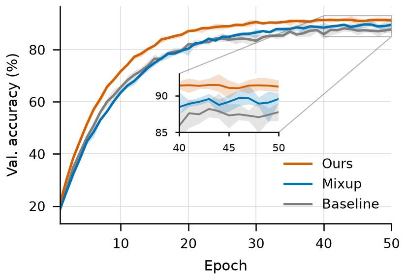</a></td><td valign="top"><a href="examples/chart-types/outputs/learning-curve.png">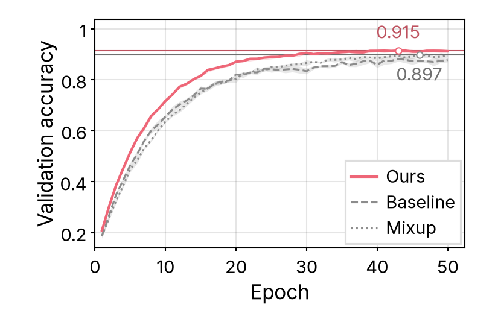</a></td></tr>
</table>

**Example 1.2** · Bar chart: Grouped bar chart, methods × benchmarks. Guidelines: [`bar-chart.md`](skills/academic-figure/bar-chart.md)

<table>
<tr><th>Without the skill</th><th>With the skill</th></tr>
<tr><td valign="top"><a href="examples/chart-types/without-skill/grouped-bar-chart.png">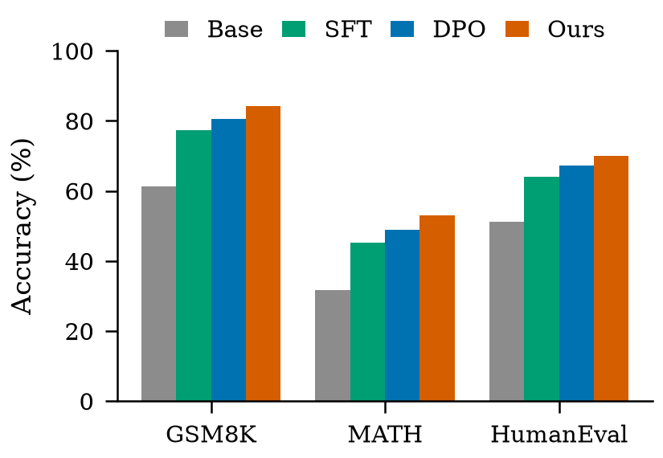</a></td><td valign="top"><a href="examples/chart-types/outputs/grouped-bar-chart.png">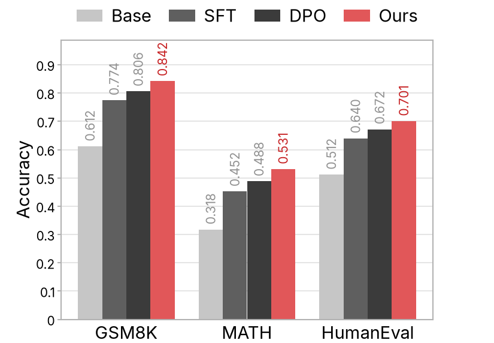</a></td></tr>
</table>

**Example 1.3** · Scatter plot: Reward score against human rating, per response. Guidelines: [`scatter-plot.md`](skills/academic-figure/scatter-plot.md)

<table>
<tr><th>Without the skill</th><th>With the skill</th></tr>
<tr><td valign="top"><a href="examples/chart-types/without-skill/correlation.png">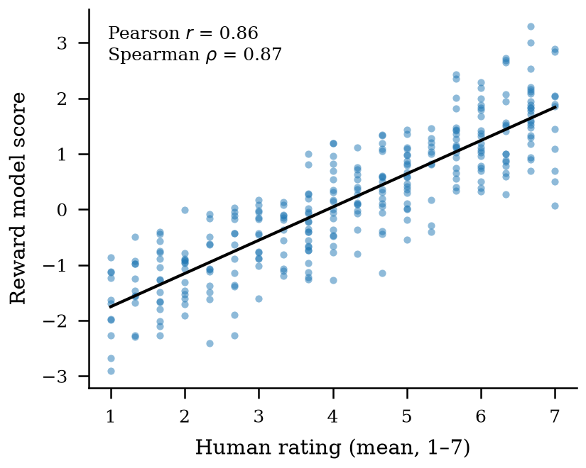</a></td><td valign="top"><a href="examples/chart-types/outputs/correlation.png">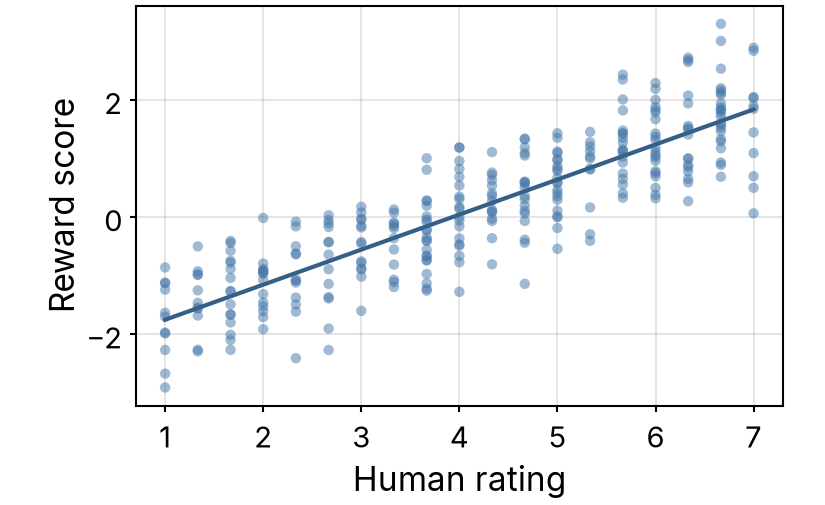</a></td></tr>
</table>

**Example 1.4** · Box plot: Grouped box plot of response lengths. Guidelines: [`box-plot.md`](skills/academic-figure/box-plot.md)

<table>
<tr><th>Without the skill</th><th>With the skill</th></tr>
<tr><td valign="top"><a href="examples/chart-types/without-skill/grouped-box-plot.png">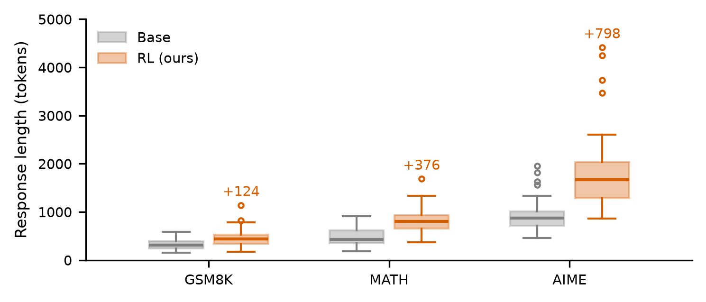</a></td><td valign="top"><a href="examples/chart-types/outputs/grouped-box-plot.png">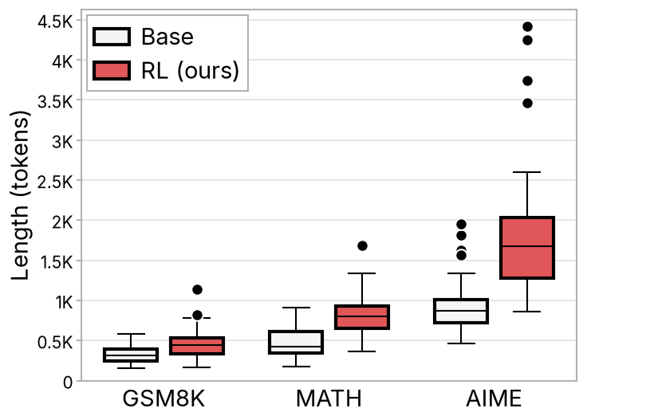</a></td></tr>
</table>

**Example 1.5** · Heatmap: Accuracy over a hyperparameter grid. Guidelines: [`heatmap.md`](skills/academic-figure/heatmap.md)

<table>
<tr><th>Without the skill</th><th>With the skill</th></tr>
<tr><td valign="top"><a href="examples/chart-types/without-skill/hyperparameter-grid.png">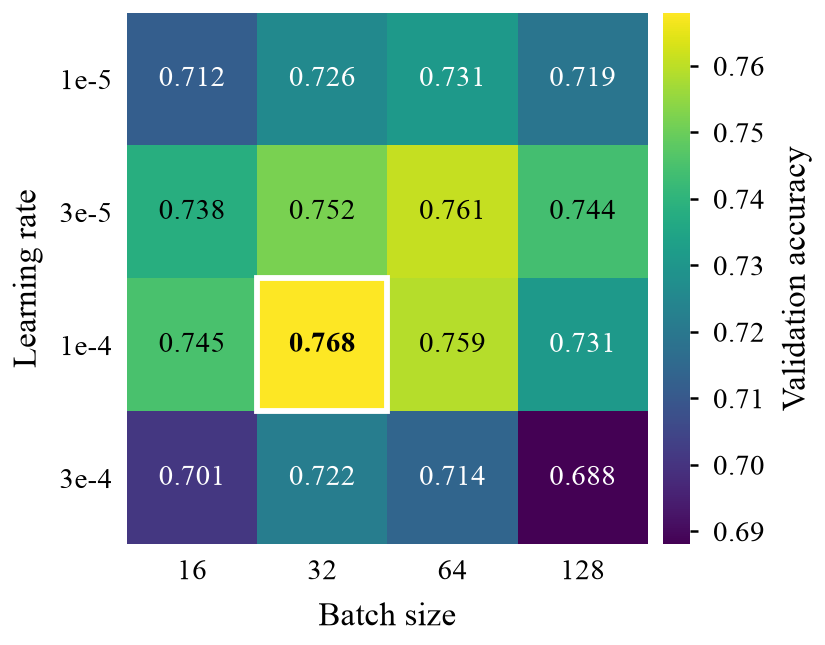</a></td><td valign="top"><a href="examples/chart-types/outputs/hyperparameter-grid.png">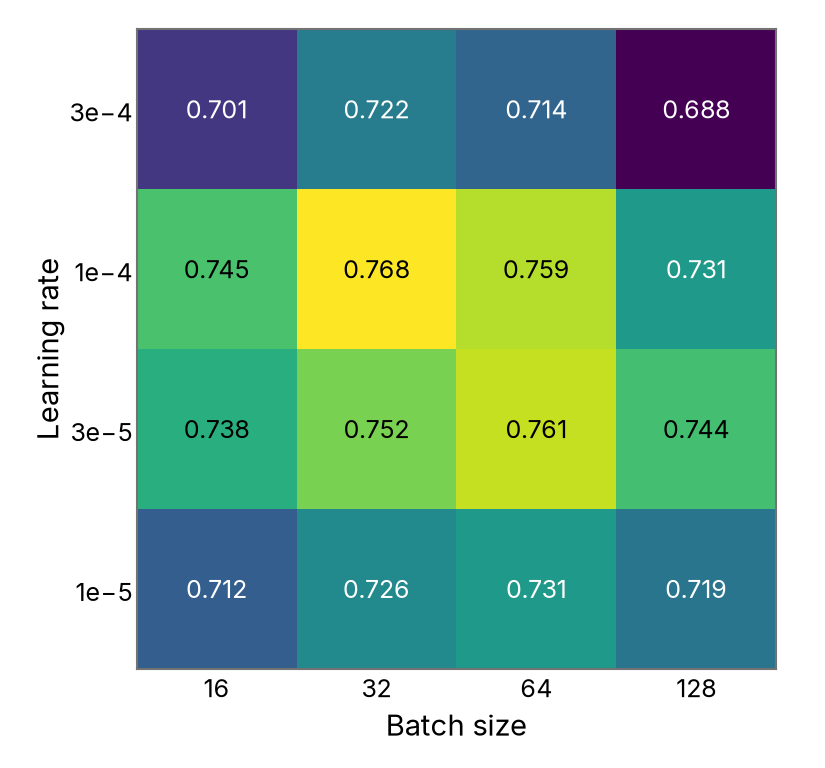</a></td></tr>
</table>

**Example 1.6** · Histogram: Overlaid histograms of confidence. Guidelines: [`histogram.md`](skills/academic-figure/histogram.md)

<table>
<tr><th>Without the skill</th><th>With the skill</th></tr>
<tr><td valign="top"><a href="examples/chart-types/without-skill/confidence-histogram.png">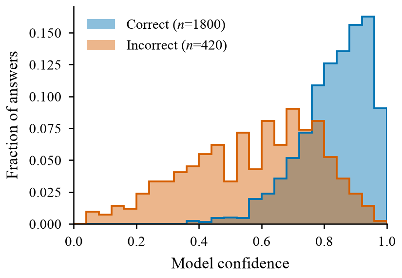</a></td><td valign="top"><a href="examples/chart-types/outputs/confidence-histogram.png">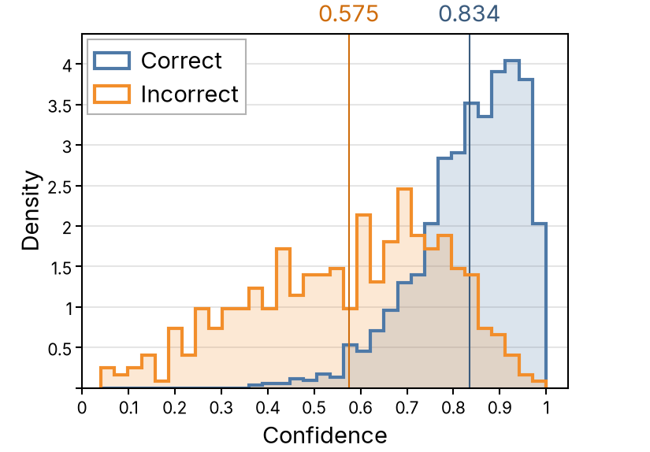</a></td></tr>
</table>

**Example 1.7** · Error bar plot: Means over seeds with ±1 std. Guidelines: [`error-bar-plot.md`](skills/academic-figure/error-bar-plot.md)

<table>
<tr><th>Without the skill</th><th>With the skill</th></tr>
<tr><td valign="top"><a href="examples/chart-types/without-skill/error-bar-plot.png">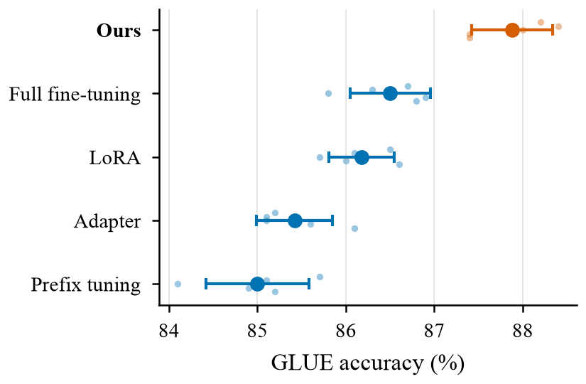</a></td><td valign="top"><a href="examples/chart-types/outputs/error-bar-plot.png">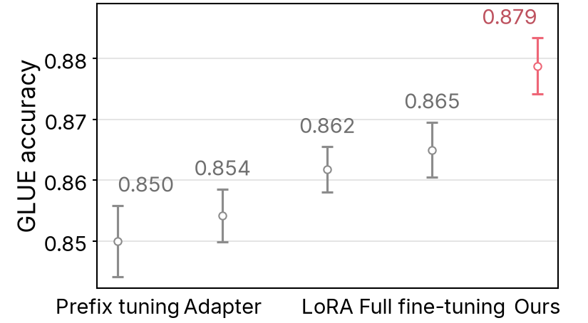</a></td></tr>
</table>

**Example 1.8** · Area chart: Stacked area chart of a data curriculum. Guidelines: [`area-chart.md`](skills/academic-figure/area-chart.md)

<table>
<tr><th>Without the skill</th><th>With the skill</th></tr>
<tr><td valign="top"><a href="examples/chart-types/without-skill/data-mixture.png">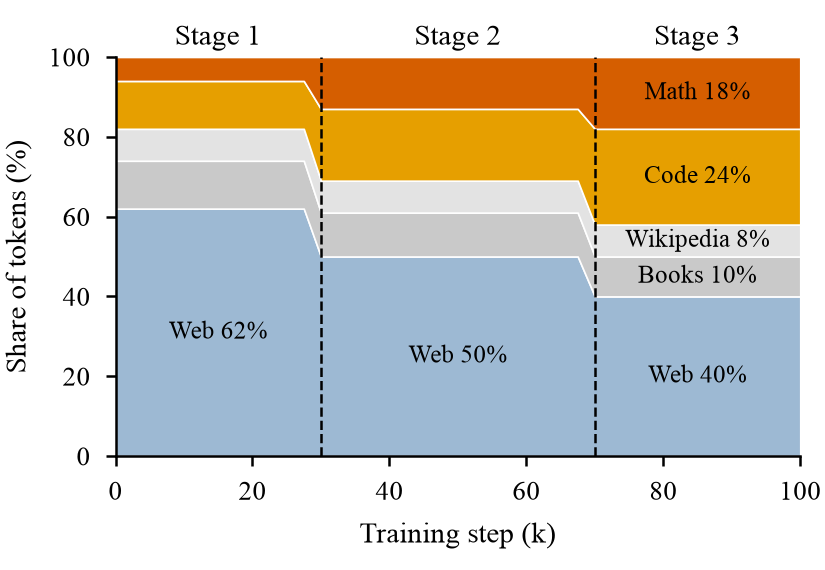</a></td><td valign="top"><a href="examples/chart-types/outputs/data-mixture.png">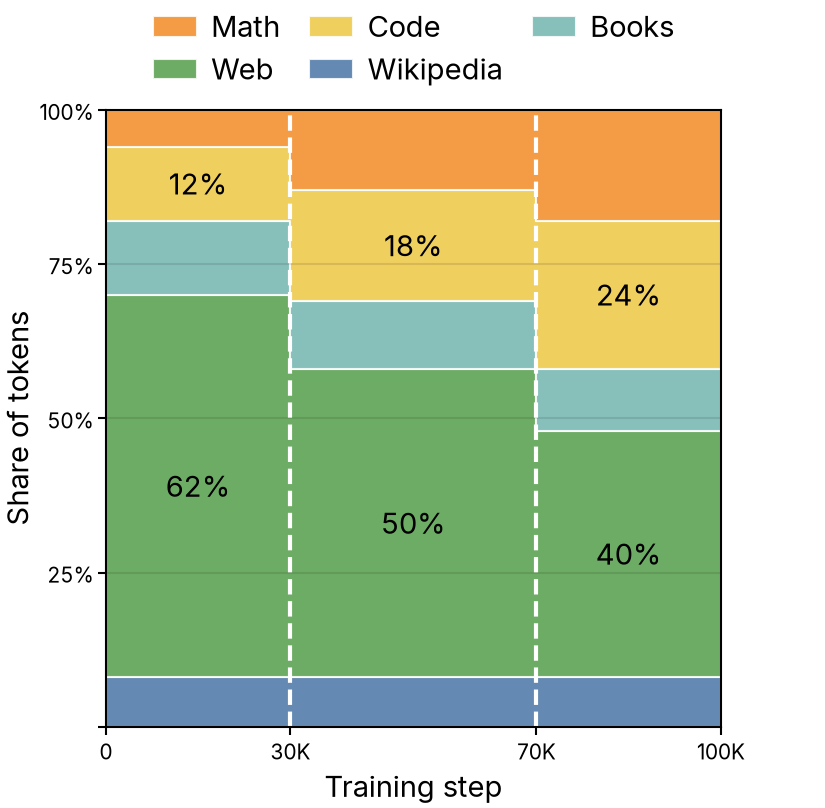</a></td></tr>
</table>

**Example 1.9** · Contour plot: Validation loss over learning rate × weight decay. Guidelines: [`contour-plot.md`](skills/academic-figure/contour-plot.md)

<table>
<tr><th>Without the skill</th><th>With the skill</th></tr>
<tr><td valign="top"><a href="examples/chart-types/without-skill/hyperparameter-surface.png">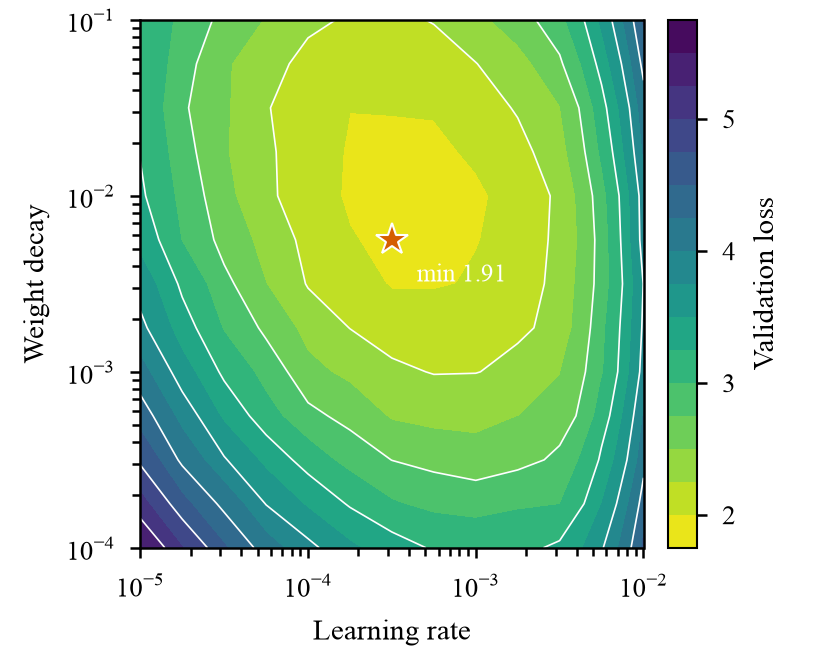</a></td><td valign="top"><a href="examples/chart-types/outputs/hyperparameter-surface.png">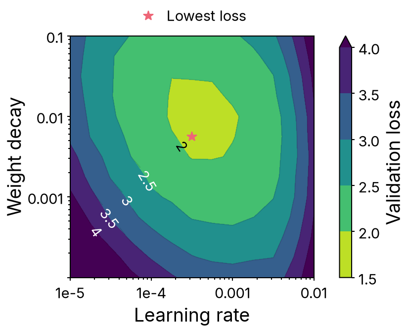</a></td></tr>
</table>

**Example 1.10** · Radar chart: Benchmark profiles of three models. Guidelines: [`radar-chart.md`](skills/academic-figure/radar-chart.md)

<table>
<tr><th>Without the skill</th><th>With the skill</th></tr>
<tr><td valign="top"><a href="examples/chart-types/without-skill/radar-chart.png">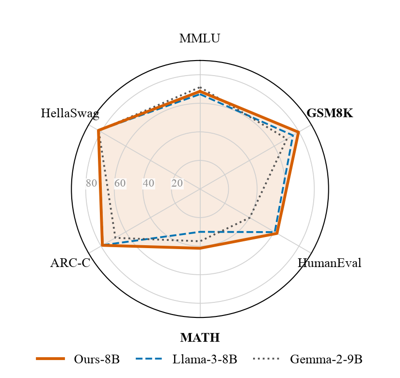</a></td><td valign="top"><a href="examples/chart-types/outputs/radar-chart.png">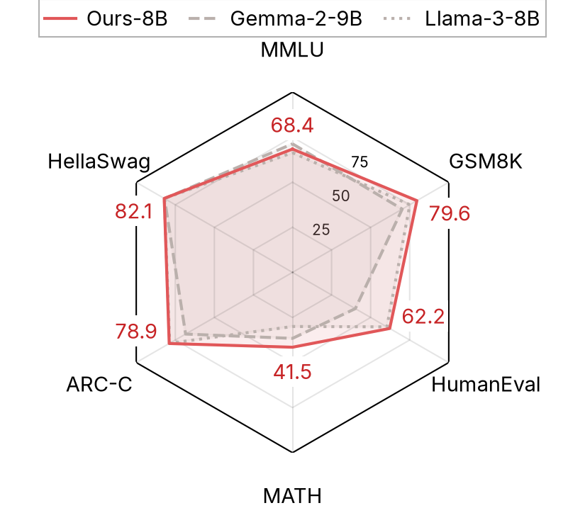</a></td></tr>
</table>

**Example 1.11** · Pie chart: Donut chart of a dataset's composition. Guidelines: [`pie-chart.md`](skills/academic-figure/pie-chart.md)

<table>
<tr><th>Without the skill</th><th>With the skill</th></tr>
<tr><td valign="top"><a href="examples/chart-types/without-skill/dataset-composition.png">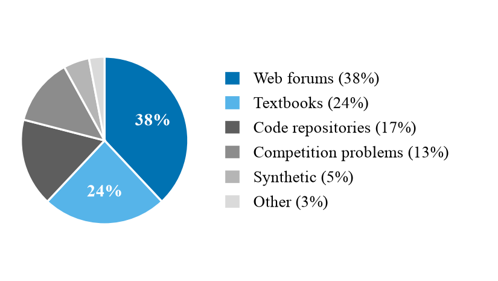</a></td><td valign="top"><a href="examples/chart-types/outputs/dataset-composition.png">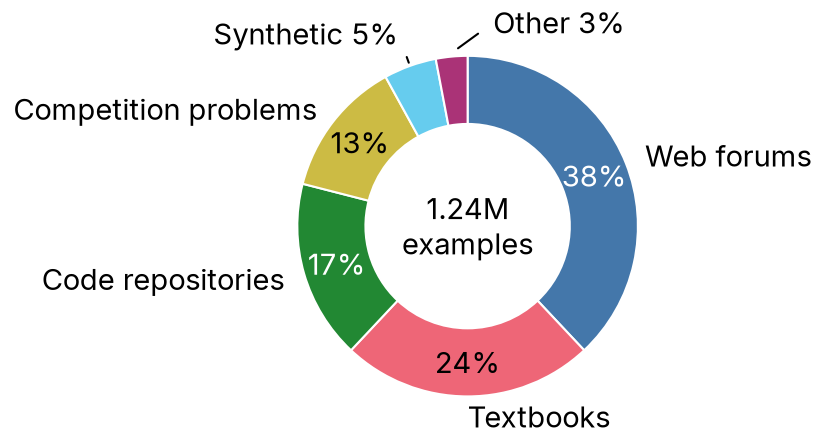</a></td></tr>
</table>

**Example 1.12** · Violin plot: Bimodal reward distributions. Guidelines: [`violin-plot.md`](skills/academic-figure/violin-plot.md)

<table>
<tr><th>Without the skill</th><th>With the skill</th></tr>
<tr><td valign="top"><a href="examples/chart-types/without-skill/reward-distribution.png">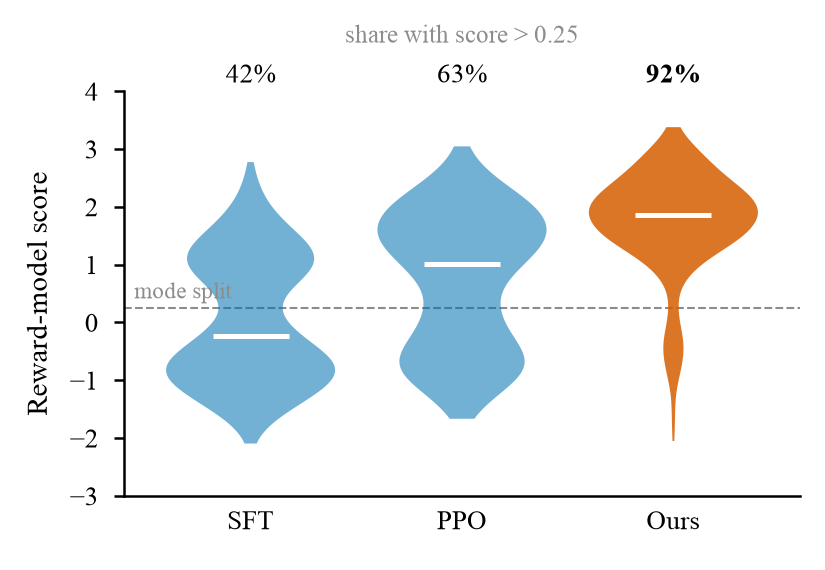</a></td><td valign="top"><a href="examples/chart-types/outputs/reward-distribution.png">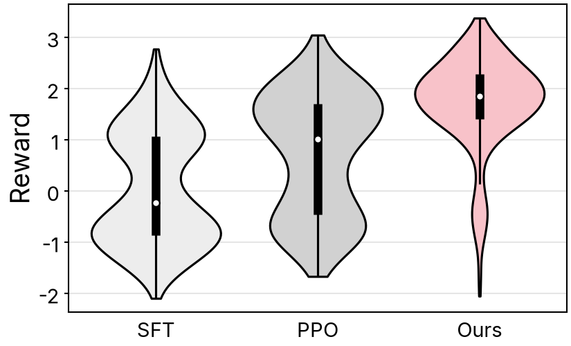</a></td></tr>
</table>

**Example 1.13** · Small multiples: One panel per dataset, ICML double column. Guidelines: [`line-chart.md`](skills/academic-figure/line-chart.md)

<table>
<tr><th>Without the skill</th><th>With the skill</th></tr>
<tr><td valign="top"><a href="examples/chart-types/without-skill/small-multiples.png">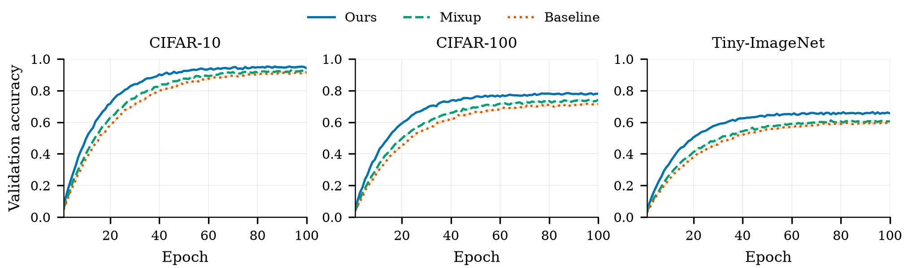</a></td><td valign="top"><a href="examples/chart-types/outputs/small-multiples.png">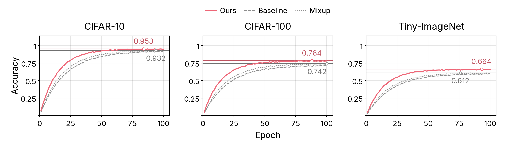</a></td></tr>
</table>

**Example 1.14** · Grouped axes: Accuracy and loss per dataset in one row, one label per group. Guidelines: [`line-chart.md`](skills/academic-figure/line-chart.md)

<table>
<tr><th>Without the skill</th><th>With the skill</th></tr>
<tr><td valign="top"><a href="examples/chart-types/without-skill/accuracy-and-loss.png">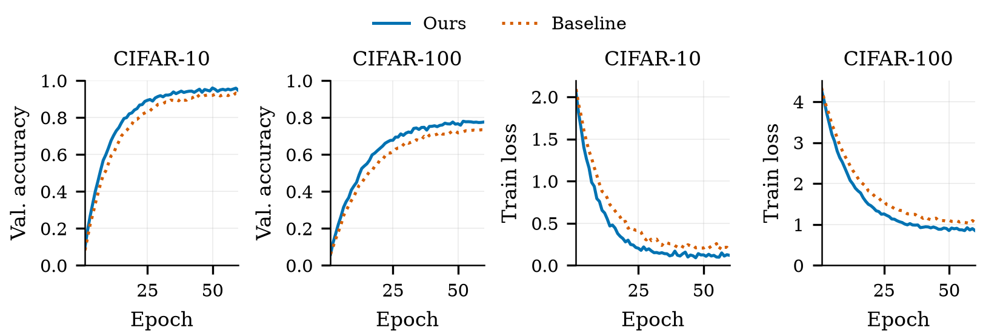</a></td><td valign="top"><a href="examples/chart-types/outputs/accuracy-and-loss.png">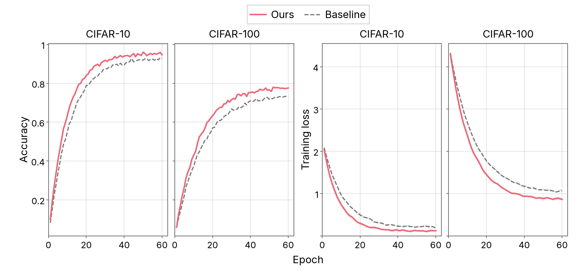</a></td></tr>
</table>

**Example 1.15** · Right y axis: Training loss with its learning-rate schedule. Guidelines: [`line-chart.md`](skills/academic-figure/line-chart.md)

<table>
<tr><th>Without the skill</th><th>With the skill</th></tr>
<tr><td valign="top"><a href="examples/chart-types/without-skill/loss-and-learning-rate.png">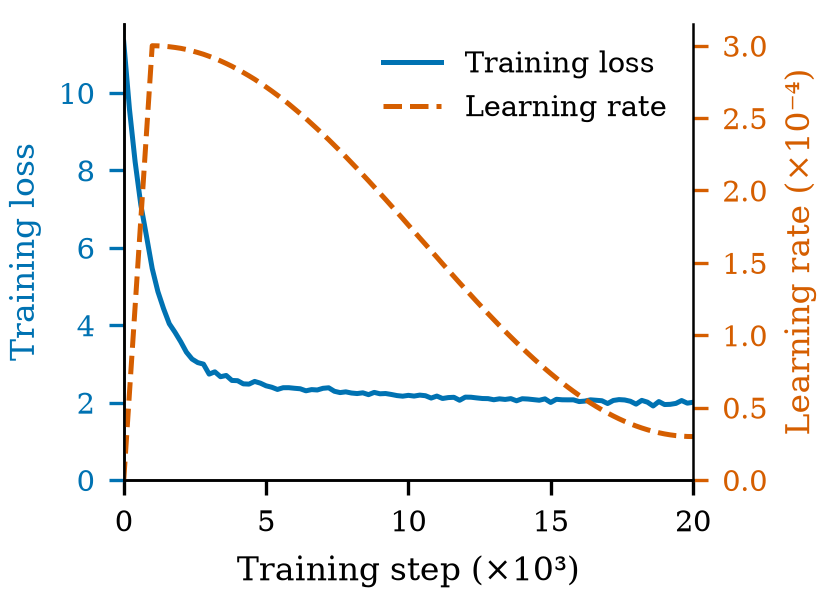</a></td><td valign="top"><a href="examples/chart-types/outputs/loss-and-learning-rate.png">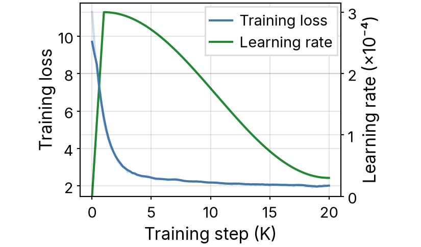</a></td></tr>
</table>

### 2. Use cases from ML papers

Figures from published papers, redrawn without any skill and following this skill (2.1–2.5, from the figures' data read from the papers' vector paths), then plots that recur across ML papers, each redrawn from a published figure with the paper's own values, recovered from the PDF (2.6–2.14).

**Example 2.1** · Line chart: DAPO, Figure 2 (left panel, single column). [DAPO: An Open-Source LLM Reinforcement Learning System at Scale](https://arxiv.org/abs/2503.14476) (Yu et al., 2025)

<table>
<tr><th>Without the skill</th><th>With the skill</th></tr>
<tr><td valign="top"><a href="examples/use-cases/without-skill/dapo-fig2.png">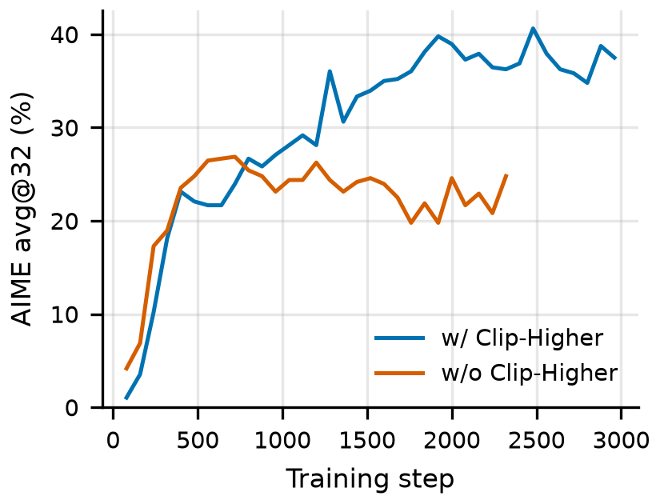</a></td><td valign="top"><a href="examples/use-cases/outputs/dapo-fig2.png">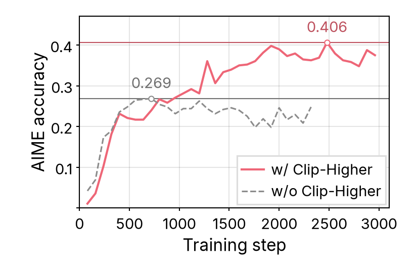</a></td></tr>
</table>

**Example 2.2** · Line chart: DAPO, Figure 6 (1.5 column). [DAPO: An Open-Source LLM Reinforcement Learning System at Scale](https://arxiv.org/abs/2503.14476) (Yu et al., 2025)

<table>
<tr><th>Without the skill</th><th>With the skill</th></tr>
<tr><td valign="top"><a href="examples/use-cases/without-skill/dapo-fig6.png">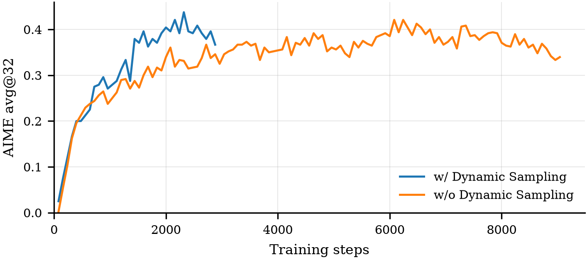</a></td><td valign="top"><a href="examples/use-cases/outputs/dapo-fig6.png">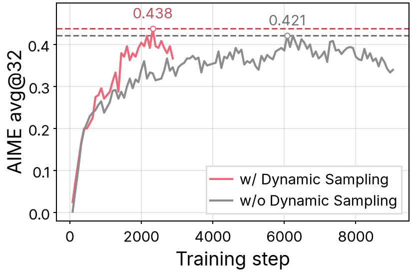</a></td></tr>
</table>

**Example 2.3** · Line chart: Does RL Really Incentivize Reasoning Capacity?, Figure 2: pass@k grid (double column). [Does Reinforcement Learning Really Incentivize Reasoning Capacity in LLMs Beyond the Base Model?](https://arxiv.org/abs/2504.13837) (Yue et al., 2025)

<table>
<tr><th>Without the skill</th><th>With the skill</th></tr>
<tr><td valign="top"><a href="examples/use-cases/without-skill/rlvr-fig2.png">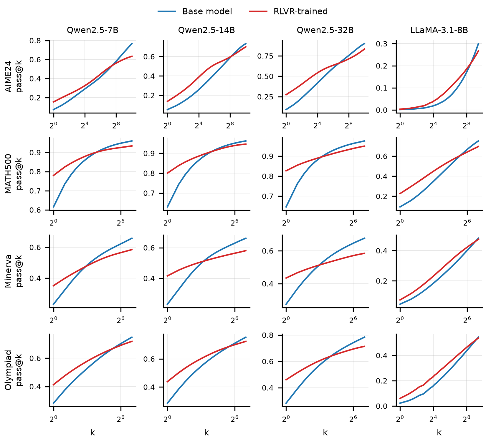</a></td><td valign="top"><a href="examples/use-cases/outputs/rlvr-fig2.png">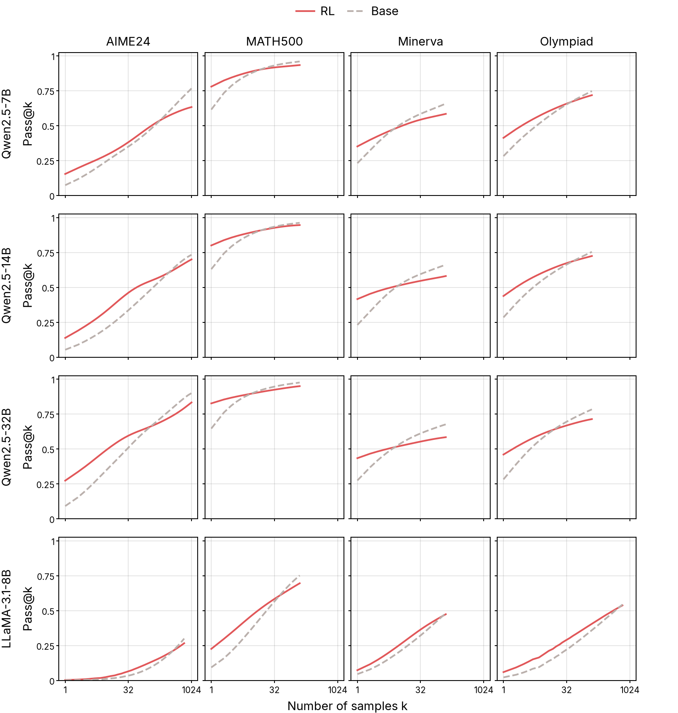</a></td></tr>
</table>

**Example 2.4** · Histogram: Does RL Really Incentivize Reasoning Capacity?, Figure 5 (single column). [Does Reinforcement Learning Really Incentivize Reasoning Capacity in LLMs Beyond the Base Model?](https://arxiv.org/abs/2504.13837) (Yue et al., 2025)

<table>
<tr><th>Without the skill</th><th>With the skill</th></tr>
<tr><td valign="top"><a href="examples/use-cases/without-skill/rlvr-fig5.png">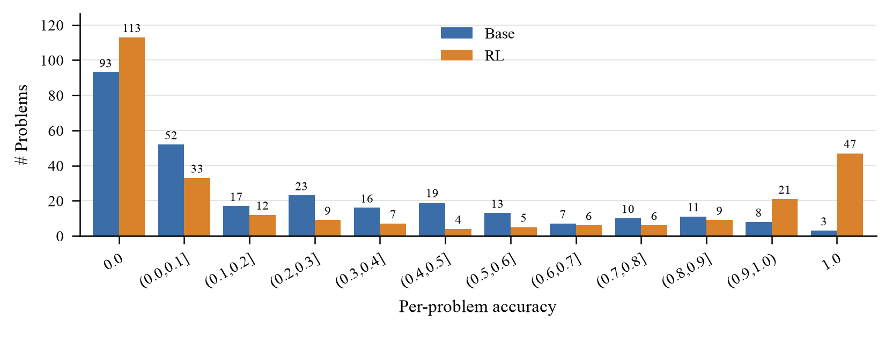</a></td><td valign="top"><a href="examples/use-cases/outputs/rlvr-fig5.png">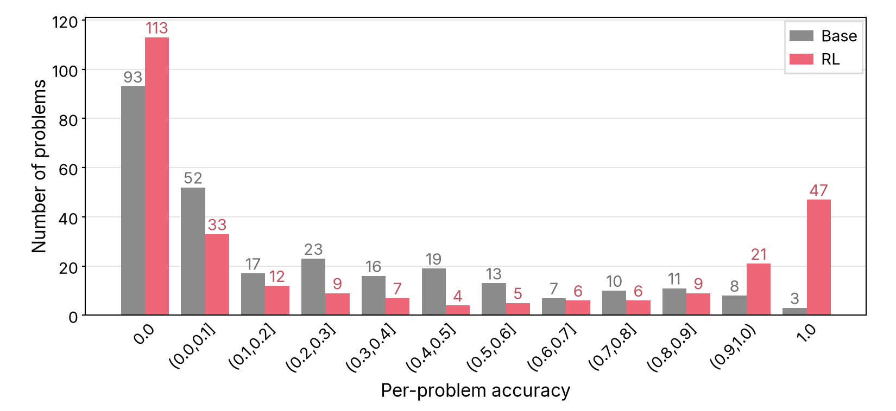</a></td></tr>
</table>

**Example 2.5** · Box plot: Does RL Really Incentivize Reasoning Capacity?, Figure 6, Problem 1 only (single column). [Does Reinforcement Learning Really Incentivize Reasoning Capacity in LLMs Beyond the Base Model?](https://arxiv.org/abs/2504.13837) (Yue et al., 2025)

<table>
<tr><th>Without the skill</th><th>With the skill</th></tr>
<tr><td valign="top"><a href="examples/use-cases/without-skill/rlvr-fig6.png">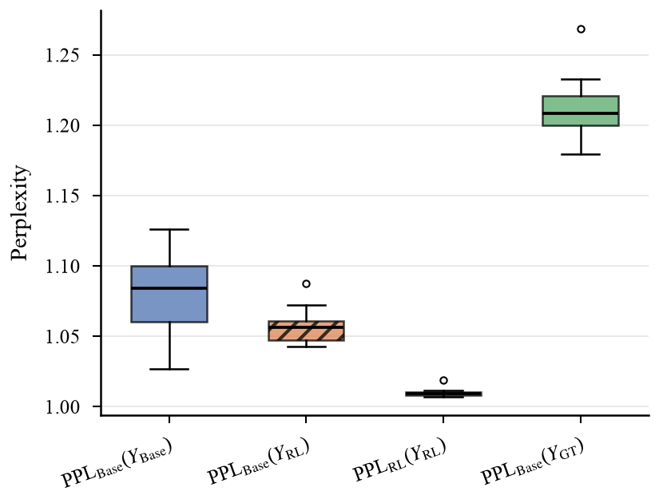</a></td><td valign="top"><a href="examples/use-cases/outputs/rlvr-fig6.png">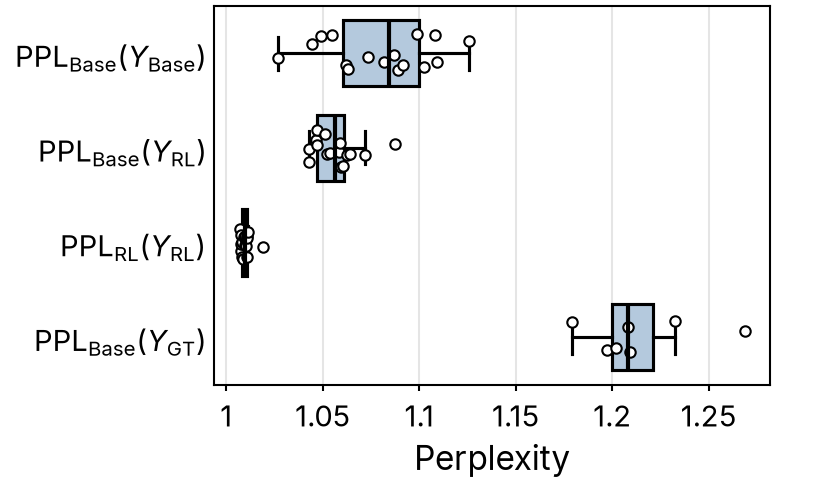</a></td></tr>
</table>

**Example 2.6** · Line chart: ROC curves of AI-text detectors. [Yang et al. (2024), DNA-GPT: Divergent N-Gram Analysis for Training-Free Detection of GPT-Generated Text](https://arxiv.org/abs/2305.17359), Figure 8 (left). Guidelines: [`line-chart.md`](skills/academic-figure/line-chart.md)

<table>
<tr><th>Without the skill</th><th>With the skill</th></tr>
<tr><td valign="top"><a href="examples/use-cases/without-skill/roc-curve.png">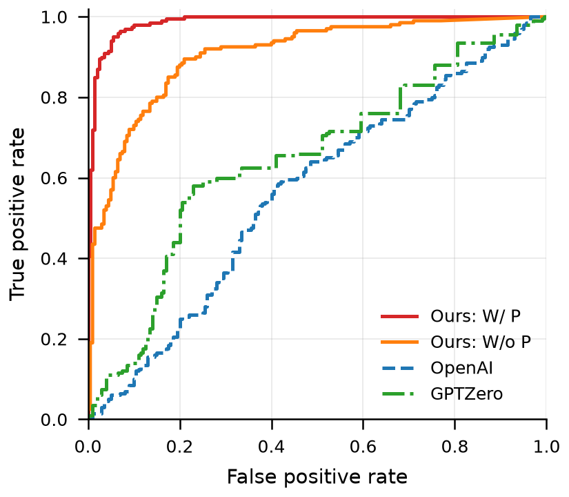</a></td><td valign="top"><a href="examples/use-cases/outputs/roc-curve.png">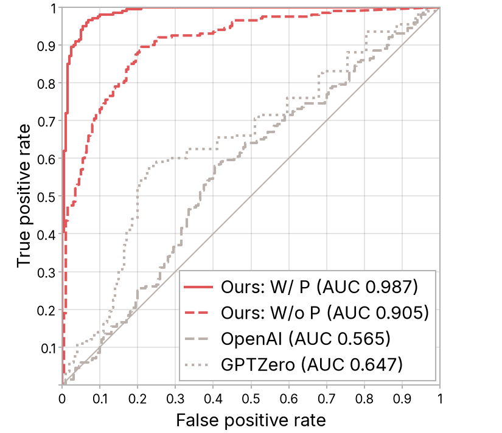</a></td></tr>
</table>

**Example 2.7** · Bar chart: Confidence histograms and reliability diagrams. [Guo et al. (2017), On Calibration of Modern Neural Networks](https://arxiv.org/abs/1706.04599), Figure 1. Guidelines: [`bar-chart.md`](skills/academic-figure/bar-chart.md)

<table>
<tr><th>Without the skill</th><th>With the skill</th></tr>
<tr><td valign="top"><a href="examples/use-cases/without-skill/reliability-diagram.png">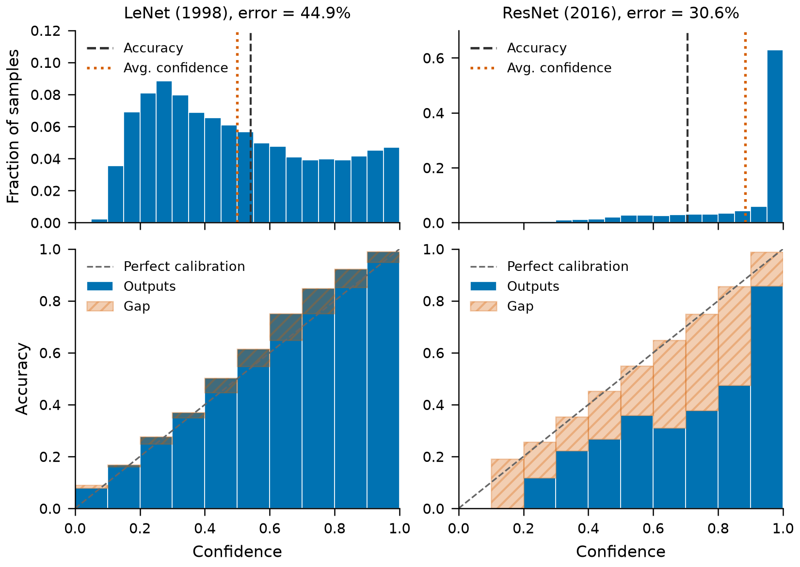</a></td><td valign="top"><a href="examples/use-cases/outputs/reliability-diagram.png">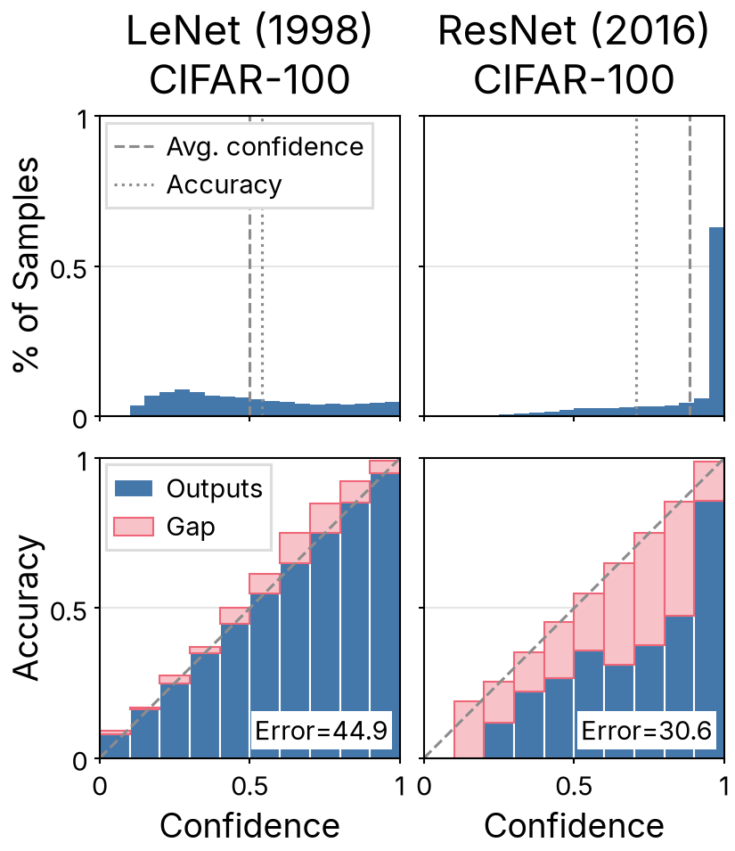</a></td></tr>
</table>

**Example 2.8** · Line chart: Scaling law with a power-law fit. [Kaplan et al. (2020), Scaling Laws for Neural Language Models](https://arxiv.org/abs/2001.08361), Figure 1 (right). Guidelines: [`line-chart.md`](skills/academic-figure/line-chart.md)

<table>
<tr><th>Without the skill</th><th>With the skill</th></tr>
<tr><td valign="top"><a href="examples/use-cases/without-skill/scaling-law.png">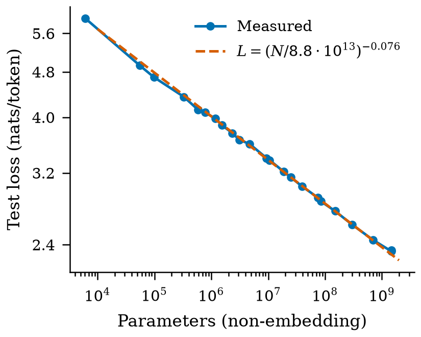</a></td><td valign="top"><a href="examples/use-cases/outputs/scaling-law.png">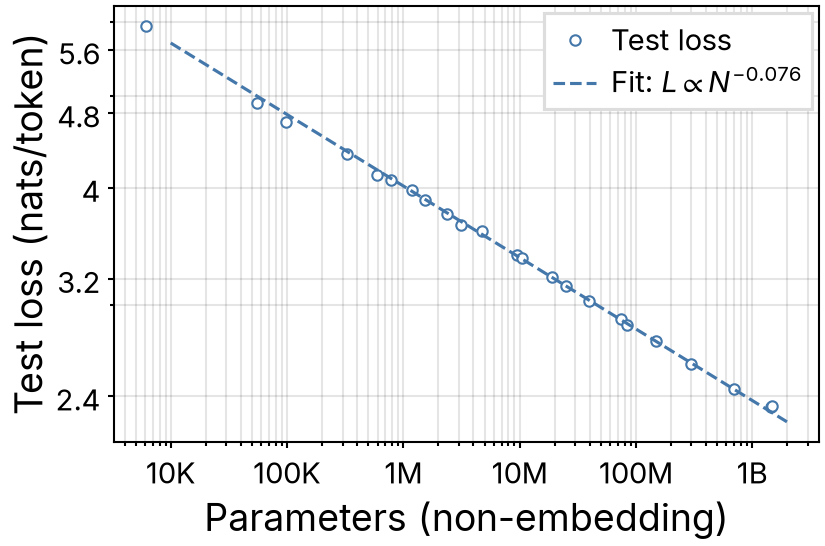</a></td></tr>
</table>

**Example 2.9** · Scatter plot: Accuracy against model size. [Tan & Le (2019), EfficientNet](https://arxiv.org/abs/1905.11946), Figure 1. Guidelines: [`scatter-plot.md`](skills/academic-figure/scatter-plot.md)

<table>
<tr><th>Without the skill</th><th>With the skill</th></tr>
<tr><td valign="top"><a href="examples/use-cases/without-skill/accuracy-vs-parameters.png">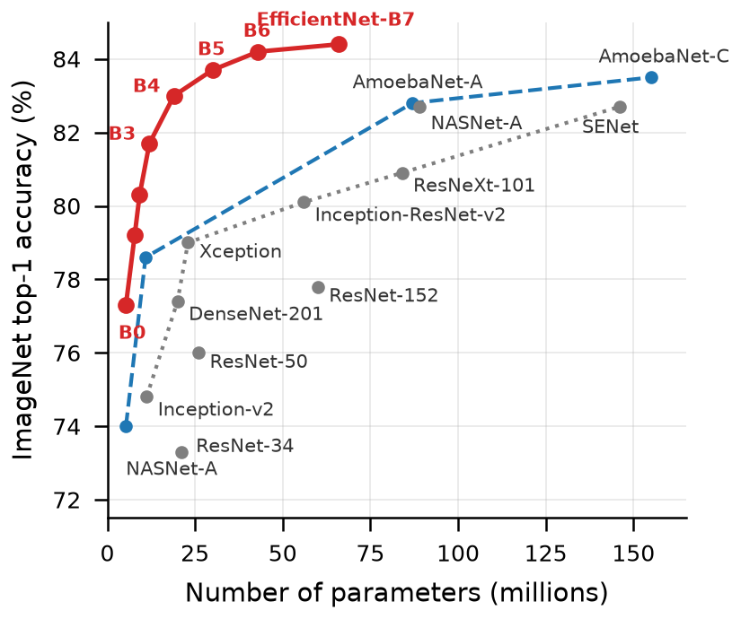</a></td><td valign="top"><a href="examples/use-cases/outputs/accuracy-vs-parameters.png">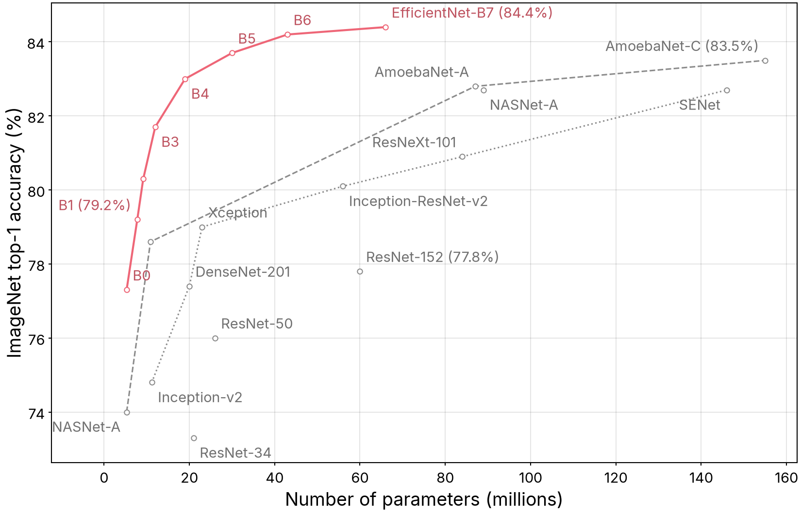</a></td></tr>
</table>

**Example 2.10** · Scatter plot: t-SNE embedding of learned features. [Lee et al. (2018), A Simple Unified Framework for Detecting Out-of-Distribution Samples and Adversarial Attacks](https://arxiv.org/abs/1807.03888), Figure 1(a). Guidelines: [`scatter-plot.md`](skills/academic-figure/scatter-plot.md)

<table>
<tr><th>Without the skill</th><th>With the skill</th></tr>
<tr><td valign="top"><a href="examples/use-cases/without-skill/t-sne.png">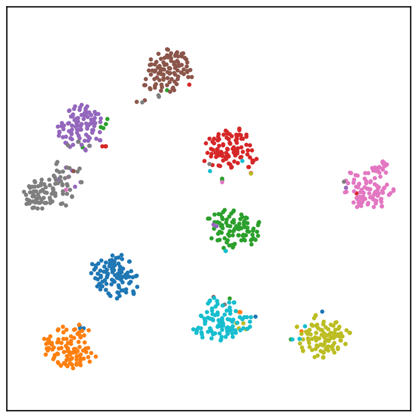</a></td><td valign="top"><a href="examples/use-cases/outputs/t-sne.png">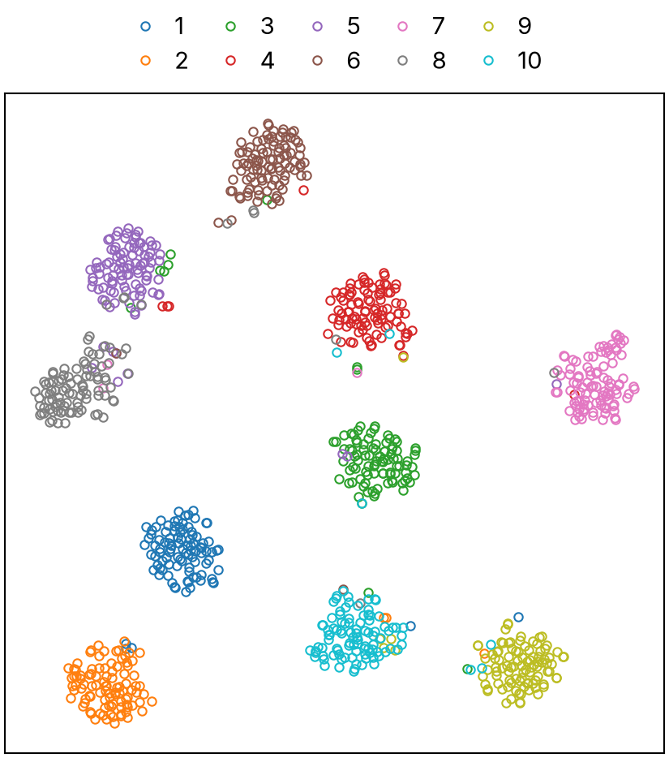</a></td></tr>
</table>

**Example 2.11** · Heatmap: Confusion matrix. [Liu (2020), Yelp Review Rating Prediction](https://arxiv.org/abs/2012.06690), Figure 5. Guidelines: [`heatmap.md`](skills/academic-figure/heatmap.md)

<table>
<tr><th>Without the skill</th><th>With the skill</th></tr>
<tr><td valign="top"><a href="examples/use-cases/without-skill/confusion-matrix.png"></a></td><td valign="top"><a href="examples/use-cases/outputs/confusion-matrix.png"></a></td></tr>
</table>

**Example 2.12** · Heatmap: Attention map (alignment). [Bahdanau et al. (2015), Neural Machine Translation by Jointly Learning to Align and Translate](https://arxiv.org/abs/1409.0473), Figure 3(a). Guidelines: [`heatmap.md`](skills/academic-figure/heatmap.md)

<table>
<tr><th>Without the skill</th><th>With the skill</th></tr>
<tr><td valign="top"><a href="examples/use-cases/without-skill/attention-map.png"></a></td><td valign="top"><a href="examples/use-cases/outputs/attention-map.png"></a></td></tr>
</table>

**Example 2.13** · Contour plot: Loss landscape. [Li et al. (2018), Visualizing the Loss Landscape of Neural Nets](https://arxiv.org/abs/1712.09913), Figure 5(b). Guidelines: [`contour-plot.md`](skills/academic-figure/contour-plot.md)

<table>
<tr><th>Without the skill</th><th>With the skill</th></tr>
<tr><td valign="top"><a href="examples/use-cases/without-skill/loss-landscape.png"></a></td><td valign="top"><a href="examples/use-cases/outputs/loss-landscape.png"></a></td></tr>
</table>

**Example 2.14** · Bar chart: Win / tie / loss rates. [Zhou et al. (2023), LIMA: Less Is More for Alignment](https://arxiv.org/abs/2305.11206), Figure 1. Guidelines: [`bar-chart.md`](skills/academic-figure/bar-chart.md)

<table>
<tr><th>Without the skill</th><th>With the skill</th></tr>
<tr><td valign="top"><a href="examples/use-cases/without-skill/win-rate.png"></a></td><td valign="top"><a href="examples/use-cases/outputs/win-rate.png"></a></td></tr>
</table>

## Install

In Claude Code:

```
/plugin marketplace add bigohofone/academic-figure-skill
/plugin install academic-figure@academic-figure-skill
```

Update with `/plugin marketplace update academic-figure-skill`.

Without the plugin system, copy the skill folder into your skills directory:

```
git clone https://github.com/bigohofone/academic-figure-skill
cp -r academic-figure-skill/skills/academic-figure ~/.claude/skills/
```

For slides in the same style, see [academic-slides-skill](https://github.com/bigohofone/academic-slides-skill).

## License

MIT, except the bundled Inter fonts (SIL Open Font License, see `skills/academic-figure/assets/Inter-LICENSE.txt`).
