# academic-figure-skill

A Claude Code skill for academic paper figures made with matplotlib or seaborn: sized to the venue's column width, print typography, color-blind-safe colors, value labels where the paper makes its claim, and a paper-style caption, delivered as cells in a `figures/figures.ipynb` notebook in your project.

## Design

How figures look is defined in [`DESIGN.md`](skills/academic-figure/assets/DESIGN.md), in the [DESIGN.md](https://github.com/google-labs-code/design.md) format: tokens (colors, type sizes, spacing, line widths) in its front matter, then Overview, Colors, Typography, Layout, Shapes, Components (the chart types) and Do's and Don'ts. The skill copies it into your project's `figures/`, and `paper.use_design()` reads its tokens to set matplotlib's style, so editing `figures/DESIGN.md` restyles every figure of that paper. [`SKILL.md`](skills/academic-figure/SKILL.md) is the workflow: takeaway, chart type, notebook, caption and checks.

## Examples

Every figure below was drawn by a Claude Code subagent with a clean context following the skill, for an ICLR paper, and is shown at its printed size (1 in = 96 px): at 100% browser zoom it appears as on the page. Open an example to see it; click a figure to open it full size.

Each group in [`examples/`](examples) holds `data/` (the input), `tasks/` (the request the subagent got), `notebooks/` (the code it wrote, runnable in place), and `outputs/` (the figures); use cases also hold `originals/` (the papers' figures) and `without-skill/`.

### 1. Chart types

The basic chart types of matplotlib and seaborn, one realistic experiment each. The data is synthetic, made to look like a real experiment.

<details>
<summary><b>Example 1.1</b> · Line chart: Learning curve, mean ± std over 5 seeds</summary>

Guidelines: [`line-chart.md`](skills/academic-figure/line-chart.md)

<a href="examples/chart-types/outputs/learning-curve.png"></a>

</details>

<details>
<summary><b>Example 1.2</b> · Bar chart: Grouped bar chart, methods × benchmarks</summary>

Guidelines: [`bar-chart.md`](skills/academic-figure/bar-chart.md)

<a href="examples/chart-types/outputs/grouped-bar-chart.png"></a>

</details>

<details>
<summary><b>Example 1.3</b> · Scatter plot: Reward score against human rating, per response</summary>

Guidelines: [`scatter-plot.md`](skills/academic-figure/scatter-plot.md)

<a href="examples/chart-types/outputs/correlation.png"></a>

</details>

<details>
<summary><b>Example 1.4</b> · Box plot: Grouped box plot of response lengths</summary>

Guidelines: [`box-plot.md`](skills/academic-figure/box-plot.md)

<a href="examples/chart-types/outputs/grouped-box-plot.png"></a>

</details>

<details>
<summary><b>Example 1.5</b> · Heatmap: Accuracy over a hyperparameter grid</summary>

Guidelines: [`heatmap.md`](skills/academic-figure/heatmap.md)

<a href="examples/chart-types/outputs/hyperparameter-grid.png"></a>

</details>

<details>
<summary><b>Example 1.6</b> · Histogram: Overlaid histograms of confidence</summary>

Guidelines: [`histogram.md`](skills/academic-figure/histogram.md)

<a href="examples/chart-types/outputs/confidence-histogram.png"></a>

</details>

<details>
<summary><b>Example 1.7</b> · Error bar plot: Means over seeds with ±1 std</summary>

Guidelines: [`error-bar-plot.md`](skills/academic-figure/error-bar-plot.md)

<a href="examples/chart-types/outputs/error-bar-plot.png"></a>

</details>

<details>
<summary><b>Example 1.8</b> · Area chart: Stacked area chart of a data curriculum</summary>

Guidelines: [`area-chart.md`](skills/academic-figure/area-chart.md)

<a href="examples/chart-types/outputs/data-mixture.png"></a>

</details>

<details>
<summary><b>Example 1.9</b> · Contour plot: Validation loss over learning rate × weight decay</summary>

Guidelines: [`contour-plot.md`](skills/academic-figure/contour-plot.md)

<a href="examples/chart-types/outputs/hyperparameter-surface.png"></a>

</details>

<details>
<summary><b>Example 1.10</b> · Radar chart: Benchmark profiles of three models</summary>

Guidelines: [`radar-chart.md`](skills/academic-figure/radar-chart.md)

<a href="examples/chart-types/outputs/radar-chart.png"></a>

</details>

<details>
<summary><b>Example 1.11</b> · Pie chart: Donut chart of a dataset's composition</summary>

Guidelines: [`pie-chart.md`](skills/academic-figure/pie-chart.md)

<a href="examples/chart-types/outputs/dataset-composition.png"></a>

</details>

<details>
<summary><b>Example 1.12</b> · Violin plot: Bimodal reward distributions</summary>

Guidelines: [`violin-plot.md`](skills/academic-figure/violin-plot.md)

<a href="examples/chart-types/outputs/reward-distribution.png"></a>

</details>

### 2. Use cases from ML papers

Figures from published papers, redrawn without any skill and following this skill (2.1–2.5, from the figures' data read from the papers' vector paths), then plots that recur across ML papers, each redrawn from a published figure with the paper's own values, recovered from the PDF (2.6–2.15), shown below the original.

<details>
<summary><b>Example 2.1</b> · Line chart: DAPO, Figure 2 (left panel, single column)</summary>

[DAPO: An Open-Source LLM Reinforcement Learning System at Scale](https://arxiv.org/abs/2503.14476) (Yu et al., 2025)

**Without skill**

<a href="examples/use-cases/without-skill/dapo-fig2.png"></a>

**With skill**

<a href="examples/use-cases/outputs/dapo-fig2.png"></a>

</details>

<details>
<summary><b>Example 2.2</b> · Line chart: DAPO, Figure 6 (1.5 column)</summary>

[DAPO: An Open-Source LLM Reinforcement Learning System at Scale](https://arxiv.org/abs/2503.14476) (Yu et al., 2025)

**Without skill**

<a href="examples/use-cases/without-skill/dapo-fig6.png"></a>

**With skill**

<a href="examples/use-cases/outputs/dapo-fig6.png"></a>

</details>

<details>
<summary><b>Example 2.3</b> · Line chart: Does RL Really Incentivize Reasoning Capacity?, Figure 2: pass@k grid (double column)</summary>

[Does Reinforcement Learning Really Incentivize Reasoning Capacity in LLMs Beyond the Base Model?](https://arxiv.org/abs/2504.13837) (Yue et al., 2025)

**Without skill**

<a href="examples/use-cases/without-skill/rlvr-fig2.png"></a>

**With skill**

<a href="examples/use-cases/outputs/rlvr-fig2.png"></a>

</details>

<details>
<summary><b>Example 2.4</b> · Histogram: Does RL Really Incentivize Reasoning Capacity?, Figure 5 (single column)</summary>

[Does Reinforcement Learning Really Incentivize Reasoning Capacity in LLMs Beyond the Base Model?](https://arxiv.org/abs/2504.13837) (Yue et al., 2025)

**Without skill**

<a href="examples/use-cases/without-skill/rlvr-fig5.png"></a>

**With skill**

<a href="examples/use-cases/outputs/rlvr-fig5.png"></a>

</details>

<details>
<summary><b>Example 2.5</b> · Box plot: Does RL Really Incentivize Reasoning Capacity?, Figure 6, Problem 1 only (single column)</summary>

[Does Reinforcement Learning Really Incentivize Reasoning Capacity in LLMs Beyond the Base Model?](https://arxiv.org/abs/2504.13837) (Yue et al., 2025)

**Without skill**

<a href="examples/use-cases/without-skill/rlvr-fig6.png"></a>

**With skill**

<a href="examples/use-cases/outputs/rlvr-fig6.png"></a>

</details>

<details>
<summary><b>Example 2.6</b> · Line chart: ROC curves on log-log axes</summary>

[Carlini et al. (2022), Membership Inference Attacks From First Principles](https://arxiv.org/abs/2112.03570), Figure 1. Guidelines: [`line-chart.md`](skills/academic-figure/line-chart.md)

**Original**

<a href="examples/use-cases/originals/roc-pr-curves.png">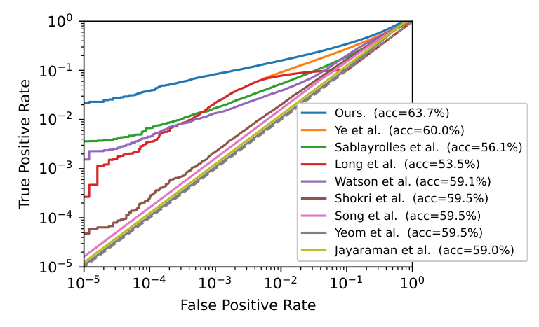</a>

**With skill**

<a href="examples/use-cases/outputs/roc-pr-curves.png">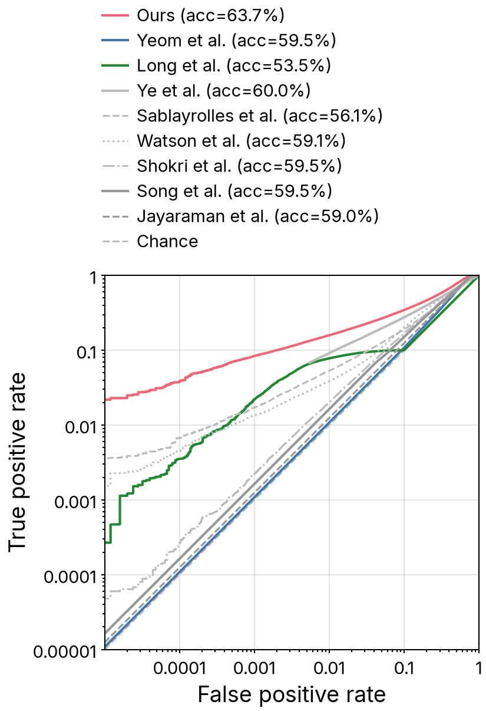</a>

</details>

<details>
<summary><b>Example 2.7</b> · Bar chart: Confidence histograms and reliability diagrams</summary>

[Guo et al. (2017), On Calibration of Modern Neural Networks](https://arxiv.org/abs/1706.04599), Figure 1. Guidelines: [`bar-chart.md`](skills/academic-figure/bar-chart.md)

**Original**

<a href="examples/use-cases/originals/reliability-diagram.png">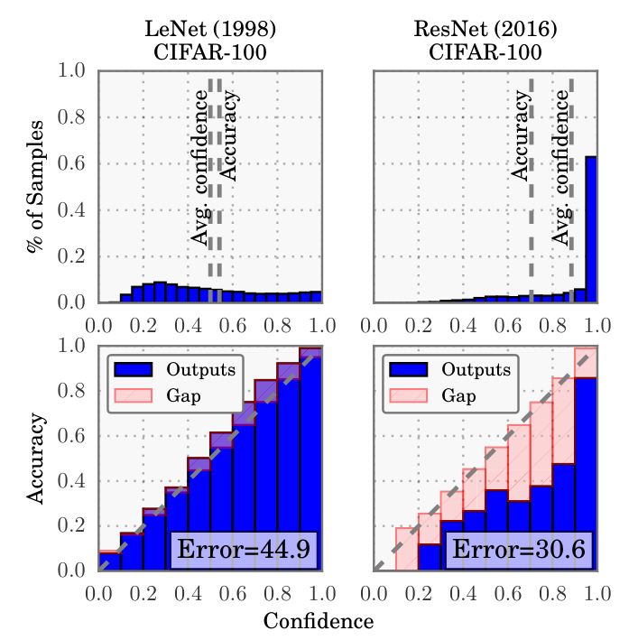</a>

**With skill**

<a href="examples/use-cases/outputs/reliability-diagram.png"></a>

</details>

<details>
<summary><b>Example 2.8</b> · Line chart: Scaling law with a power-law fit</summary>

[Kaplan et al. (2020), Scaling Laws for Neural Language Models](https://arxiv.org/abs/2001.08361), Figure 1 (right). Guidelines: [`line-chart.md`](skills/academic-figure/line-chart.md)

**Original**

<a href="examples/use-cases/originals/scaling-law.png">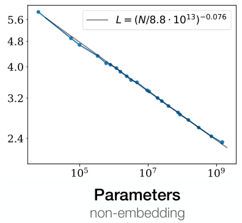</a>

**With skill**

<a href="examples/use-cases/outputs/scaling-law.png"></a>

</details>

<details>
<summary><b>Example 2.9</b> · Scatter plot: Accuracy against model size</summary>

[Tan & Le (2019), EfficientNet](https://arxiv.org/abs/1905.11946), Figure 1. Guidelines: [`scatter-plot.md`](skills/academic-figure/scatter-plot.md)

**Original**

<a href="examples/use-cases/originals/accuracy-vs-parameters.png">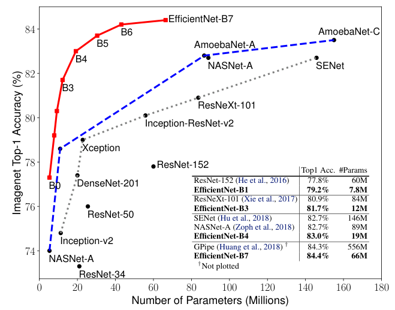</a>

**With skill**

<a href="examples/use-cases/outputs/accuracy-vs-parameters.png"></a>

</details>

<details>
<summary><b>Example 2.10</b> · Scatter plot: t-SNE embedding of learned features</summary>

[Lee et al. (2018), A Simple Unified Framework for Detecting Out-of-Distribution Samples and Adversarial Attacks](https://arxiv.org/abs/1807.03888), Figure 1(a). Guidelines: [`scatter-plot.md`](skills/academic-figure/scatter-plot.md)

**Original**

<a href="examples/use-cases/originals/t-sne.png">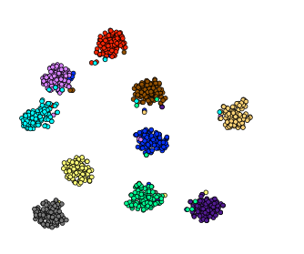</a>

**With skill**

<a href="examples/use-cases/outputs/t-sne.png"></a>

</details>

<details>
<summary><b>Example 2.11</b> · Heatmap: Confusion matrix</summary>

[Liu (2020), Yelp Review Rating Prediction](https://arxiv.org/abs/2012.06690), Figure 5. Guidelines: [`heatmap.md`](skills/academic-figure/heatmap.md)

**Original**

<a href="examples/use-cases/originals/confusion-matrix.png">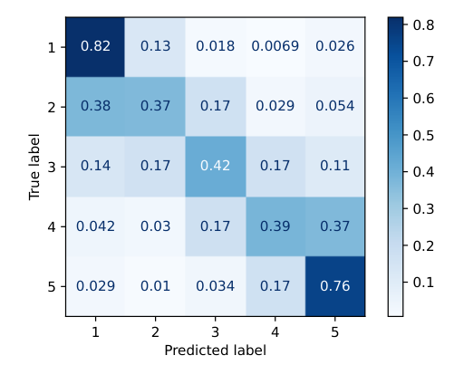</a>

**With skill**

<a href="examples/use-cases/outputs/confusion-matrix.png"></a>

</details>

<details>
<summary><b>Example 2.12</b> · Heatmap: Attention map (alignment)</summary>

[Bahdanau et al. (2015), Neural Machine Translation by Jointly Learning to Align and Translate](https://arxiv.org/abs/1409.0473), Figure 3(a). Guidelines: [`heatmap.md`](skills/academic-figure/heatmap.md)

**Original**

<a href="examples/use-cases/originals/attention-map.png">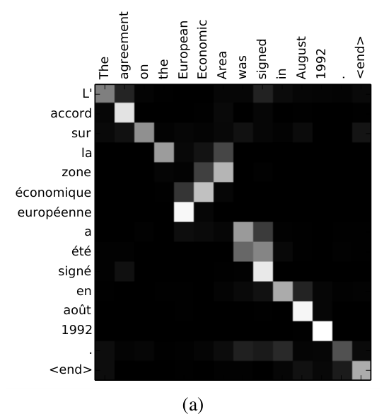</a>

**With skill**

<a href="examples/use-cases/outputs/attention-map.png"></a>

</details>

<details>
<summary><b>Example 2.13</b> · Contour plot: Loss landscape</summary>

[Li et al. (2018), Visualizing the Loss Landscape of Neural Nets](https://arxiv.org/abs/1712.09913), Figure 5(b). Guidelines: [`contour-plot.md`](skills/academic-figure/contour-plot.md)

**Original**

<a href="examples/use-cases/originals/loss-landscape.png">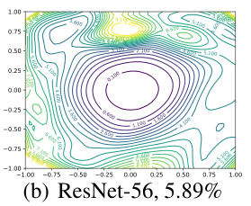</a>

**With skill**

<a href="examples/use-cases/outputs/loss-landscape.png"></a>

</details>

<details>
<summary><b>Example 2.14</b> · Bar chart: Win / tie / loss rates</summary>

[Zhou et al. (2023), LIMA: Less Is More for Alignment](https://arxiv.org/abs/2305.11206), Figure 1. Guidelines: [`bar-chart.md`](skills/academic-figure/bar-chart.md)

**Original**

<a href="examples/use-cases/originals/win-rate.png">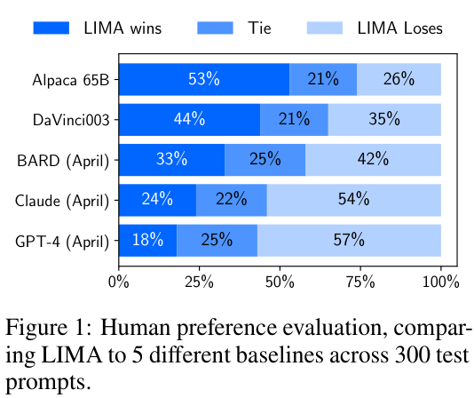</a>

**With skill**

<a href="examples/use-cases/outputs/win-rate.png"></a>

</details>

<details>
<summary><b>Example 2.15</b> · Bar chart: Failure-mode breakdown per system</summary>

[Cemri et al. (2025), Why Do Multi-Agent LLM Systems Fail?](https://arxiv.org/abs/2503.13657), Figure 4. Guidelines: [`bar-chart.md`](skills/academic-figure/bar-chart.md)

**Original**

<a href="examples/use-cases/originals/stacked-bar-chart.png">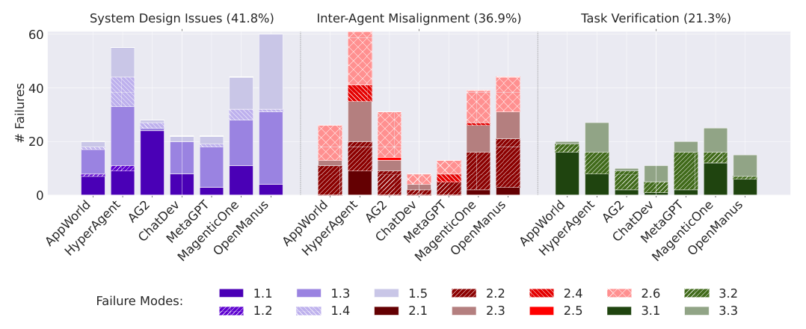</a>

**With skill**

<a href="examples/use-cases/outputs/stacked-bar-chart.png">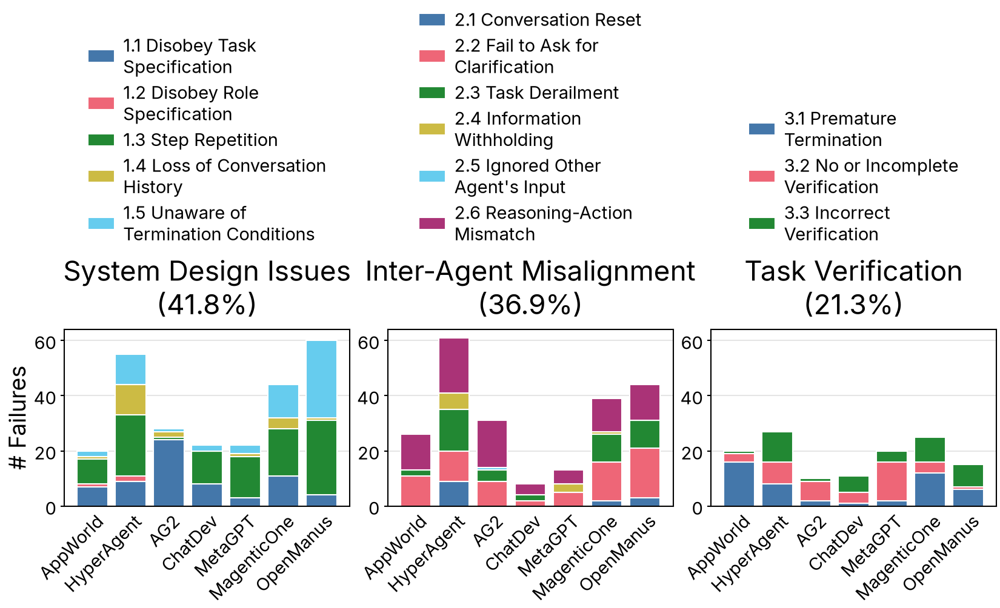</a>

</details>

## Install

In Claude Code:

```
/plugin marketplace add bigohofone/academic-figure-skill
/plugin install academic-figure@academic-figure-skill
```

Update with `/plugin marketplace update academic-figure-skill`.

Without the plugin system, copy the skill folder into your skills directory:

```
git clone https://github.com/bigohofone/academic-figure-skill
cp -r academic-figure-skill/skills/academic-figure ~/.claude/skills/
```

For slides in the same style, see [academic-slides-skill](https://github.com/bigohofone/academic-slides-skill).

## License

MIT, except the bundled Inter fonts (SIL Open Font License, see `skills/academic-figure/assets/Inter-LICENSE.txt`).
