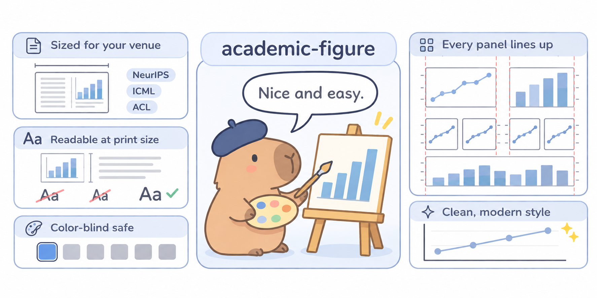
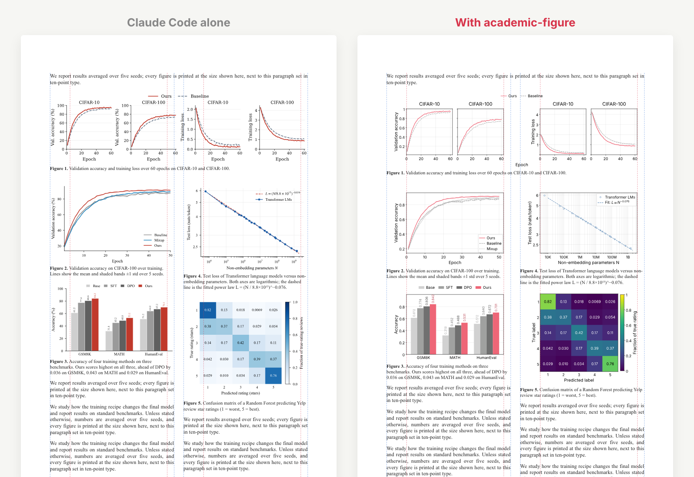

# academic-figure

[](https://github.com/bigohofone/academic-figure-skill/stargazers) [](https://wonjunoh.com/academic-figure-skill/)

**Stop fixing figures the night before the deadline.**

A Claude Code skill for paper figures. Ask for a plot as usual and get one that is ready for the paper: the right size for your venue, readable at print size, and consistent with every other figure.



## Same request, with and without

The same data and the same request, on an ICML page at print size. Nothing was touched by hand.



## What you get

- **Sized for your venue**: NeurIPS, ICML, ICLR, CVPR, ACL. One column, both columns, or half the text width, exactly.
- **Readable at print size**: labels and ticks just under the body text, in one font, in every figure.
- **Color-blind safe**: your method stands out in one color and the baselines step back in grey.
- **Every panel lines up**: single panels, grids and full-width figures start and end on the same edges.
- **Clean, modern style**: nothing overlaps, nothing is cut off, no legend on top of the data.
- **Nice and easy**: you get the figure, a caption ready to paste, and one short script to rerun or tweak.

Works with every matplotlib and seaborn chart: lines, bars, scatter, box and violin plots, histograms, heatmaps, contours, radar, pie and area charts. See all 28 examples, before and after, on the [project site](https://wonjunoh.com/academic-figure-skill/#gallery).

## Install

In Claude Code:

```
/plugin marketplace add bigohofone/academic-figure-skill
/plugin install academic-figure@academic-figure-skill
```

Then just ask:

> plot the learning curves in results.json for my ICLR paper

Each figure comes as `figures/<id>.py`, with its caption as the docstring, and its PDF and PNG in `figures/outputs/`. To restyle every figure of a paper at once, edit `figures/DESIGN.md`.

Without the plugin system, copy the skill folder into your skills directory:

```
git clone https://github.com/bigohofone/academic-figure-skill
cp -r academic-figure-skill/skills/academic-figure ~/.claude/skills/
```

For slides in the same style, see [academic-slides-skill](https://github.com/bigohofone/academic-slides-skill).

## License

MIT, except the bundled Inter fonts (SIL Open Font License, see `skills/academic-figure/assets/Inter-LICENSE.txt`).
