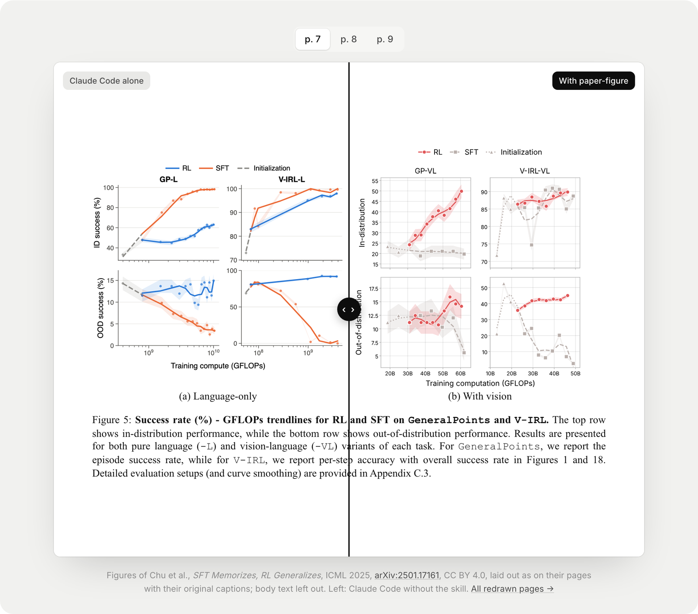
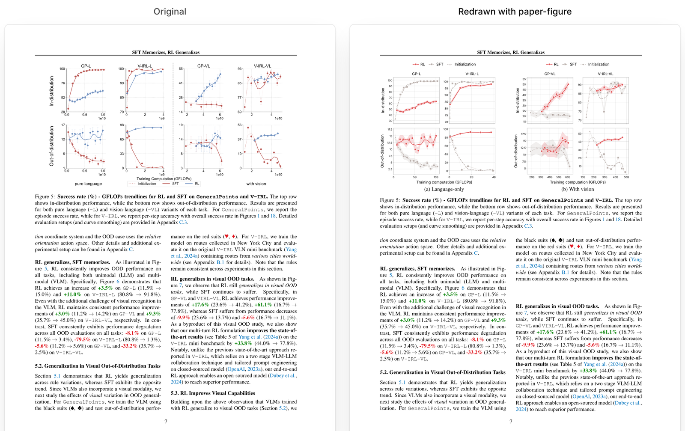
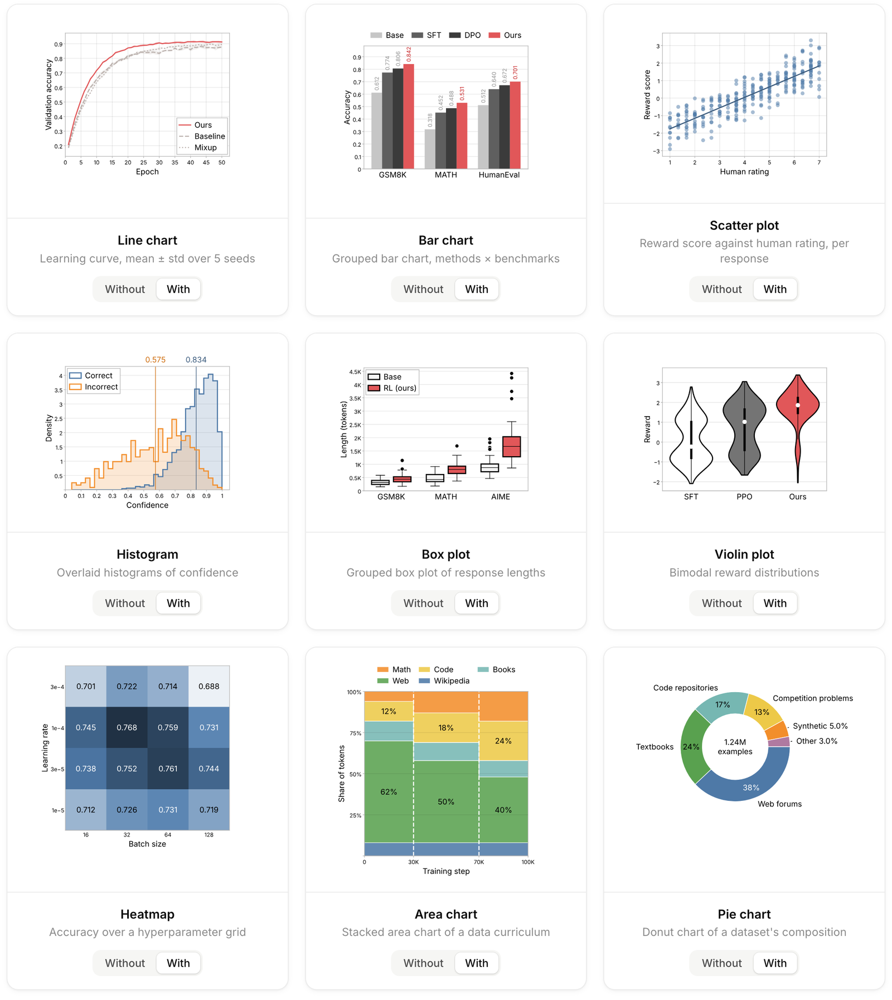

# paper-figure

**Paper-ready figures. Right from Claude Code.**

Ask for a plot. Get a figure sized for your venue, readable in print and consistent across your paper. A Claude Code skill for matplotlib and seaborn.

[Website](https://wonjunoh.com/paper-figure-skill/) · [Real papers](https://wonjunoh.com/paper-figure-skill/papers/) · [Chart gallery](https://wonjunoh.com/paper-figure-skill/charts/) · [Panel layouts](https://wonjunoh.com/paper-figure-skill/layouts/)



<sub>Figures of Chu et al., *SFT Memorizes, RL Generalizes*, ICML 2025, [arXiv:2501.17161](https://arxiv.org/abs/2501.17161), [CC BY 4.0](https://creativecommons.org/licenses/by/4.0/). Same data on both sides.</sub>

## Install

Two commands in Claude Code.

```
/plugin marketplace add bigohofone/paper-figure-skill
/plugin install paper-figure@paper-figure-skill
```

## Just ask

Nothing to learn, nothing to set up. Name your data and your venue.

> plot the learning curves in results.json for my ICLR paper

You get a print-ready PDF and PNG, and a caption built from your data.

```
figures/
├── learning-curves.py    # the script, its caption as the docstring
├── DESIGN.md             # one file for the look of every figure
└── outputs/
    ├── learning-curves.pdf
    └── learning-curves.png
```

## What every figure gets

- **Sized for your venue.** The exact column or text width of NeurIPS, ICML, ICLR, CVPR and ACL, or any venue you name.
- **Readable in print.** Text sized for the printed page, in one font, the same in every figure.
- **Your method stands out.** Ours in one color, baselines in grey, checked to stay apart in black and white.
- **Panels line up.** Single panels, grids and full-width figures start and end on the same edges.
- **Nothing overlaps.** Legends and labels go where they hide no data, and nothing is cut off.
- **Numbers from your data.** Every number on the plot and in the caption is computed, never typed.

## Real papers. Redrawn.

Three published papers, their plots redrawn from the original numbers. Same pages. Same captions.



[Compare every page →](https://wonjunoh.com/paper-figure-skill/papers/)

## Every chart. Done right.

Lines, bars, scatter, histograms, box and violin plots, heatmaps, areas, pies, contours and error bars.



[See them with and without the skill →](https://wonjunoh.com/paper-figure-skill/charts/)

## Your style, everywhere

Every color, font, size and line weight lives in `figures/DESIGN.md`. Change it once and every figure of the paper follows.

## Without the plugin system

```
git clone https://github.com/bigohofone/paper-figure-skill
cp -r paper-figure-skill/skills/paper-figure ~/.claude/skills/
```

For slides in the same style, see [academic-slides-skill](https://github.com/bigohofone/academic-slides-skill).

## License

MIT, except the bundled Inter fonts (SIL Open Font License, see `skills/paper-figure/assets/paper/Inter-LICENSE.txt`).
