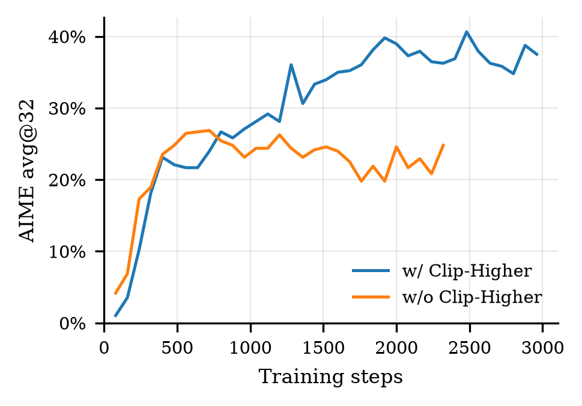
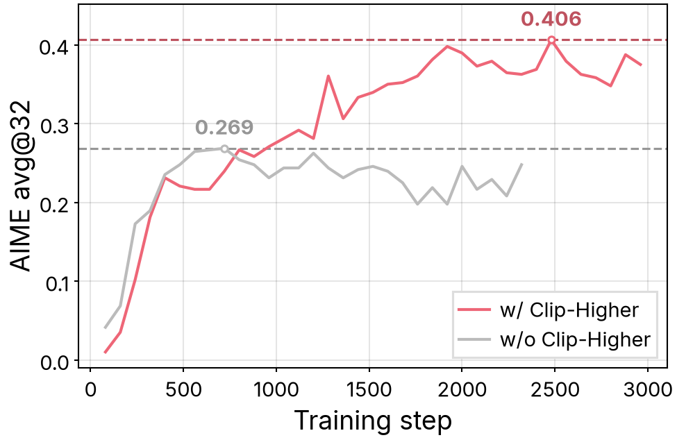
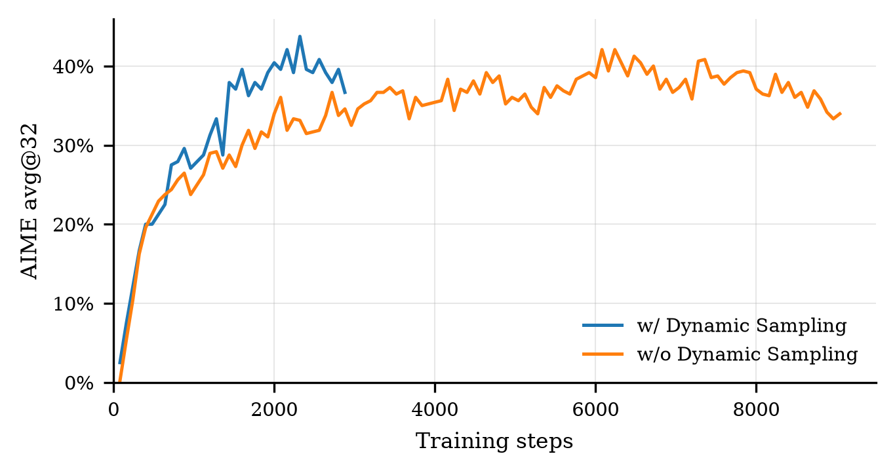
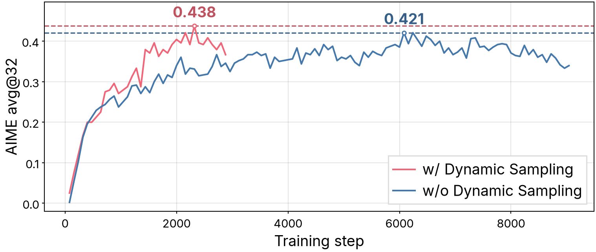
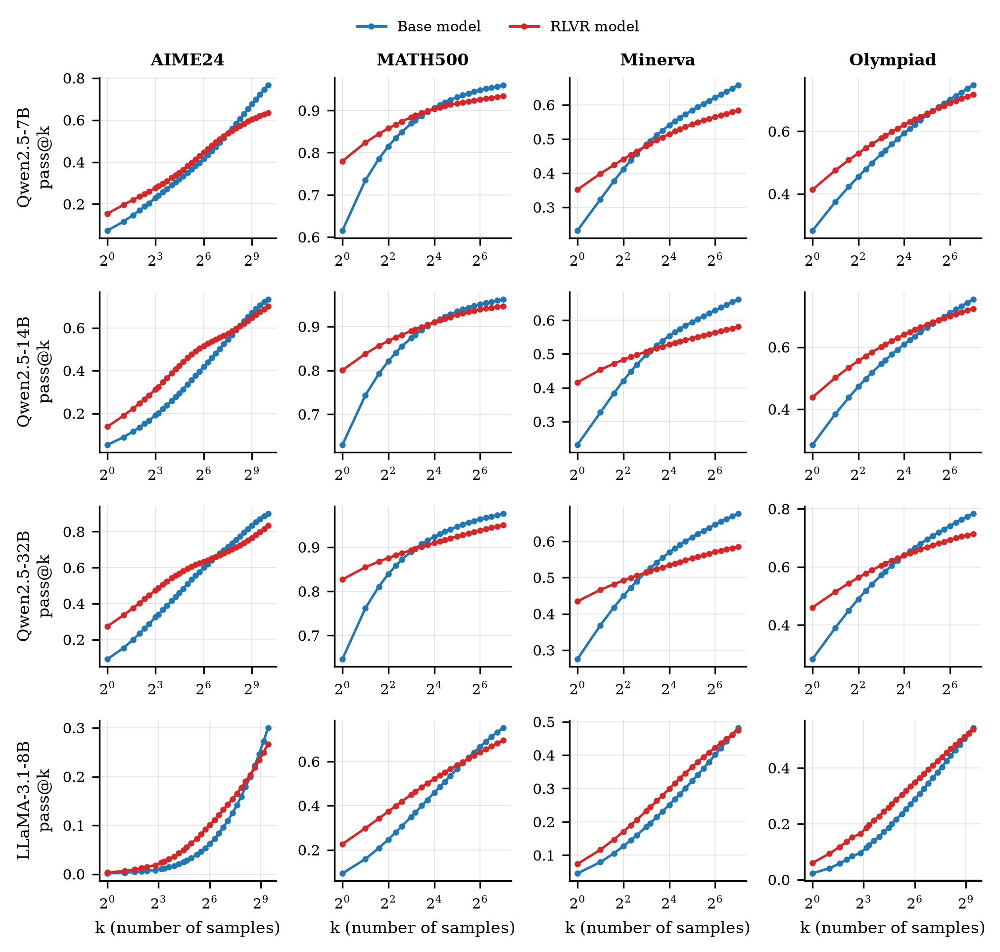
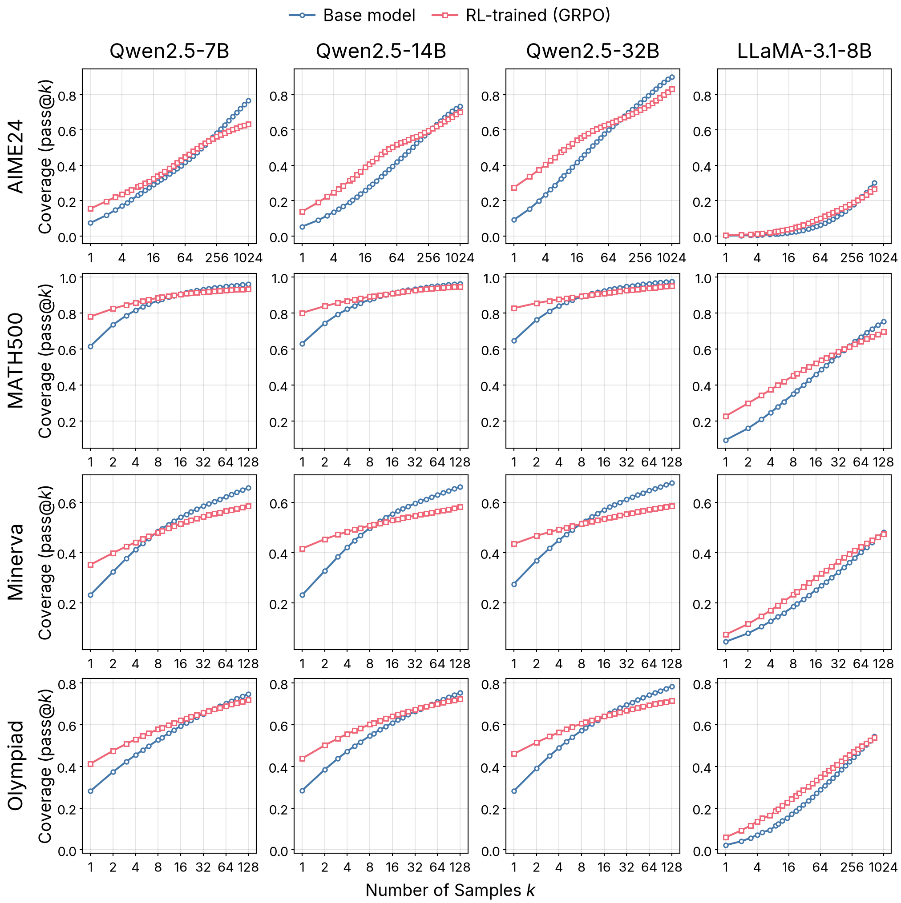
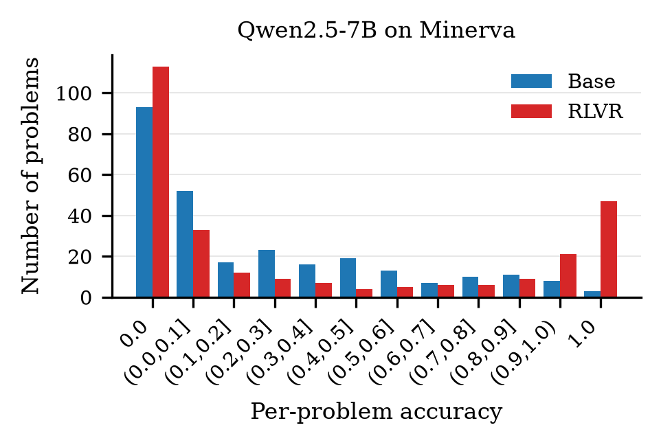
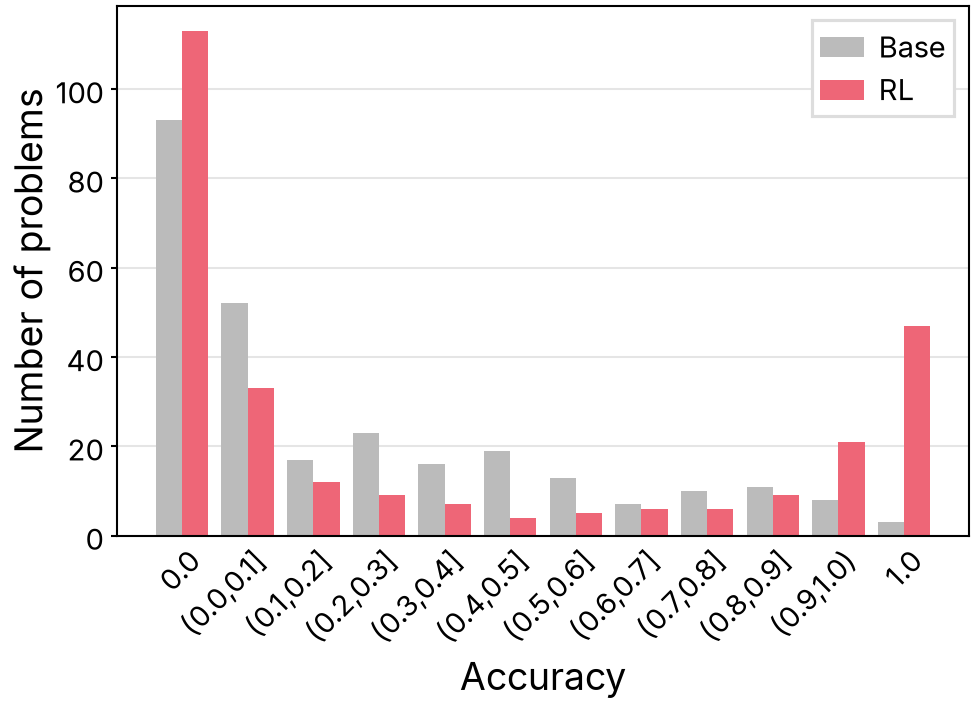
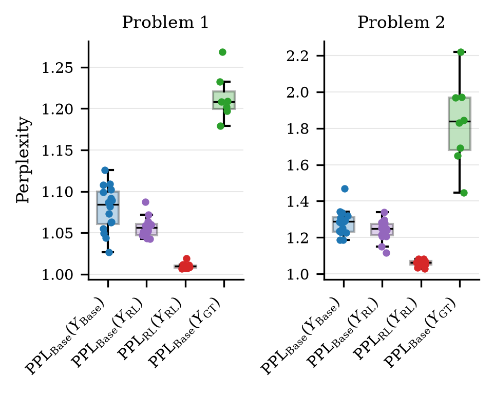
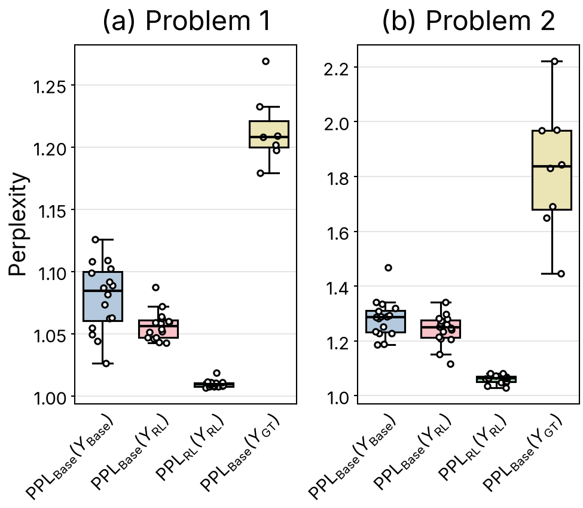

# academic-figure-skill

A Claude Code skill for academic paper figures made with matplotlib or seaborn: sized to the venue's column width, print typography, color-blind-safe colors, value labels where the paper makes its claim, and a paper-style caption, delivered as cells in a `figures/figures.ipynb` notebook in your project.

## Examples

Figures from published papers, redrawn by Claude Code subagents with a clean context: without any skill (left) and following this skill (right). Both get only the figure's data, read from the paper's vector paths, and the same task file describing the figure. Click a figure to see it full size.

<table>
<tr><th width="50%">Without skill</th><th width="50%">With skill</th></tr>
<tr><td colspan="2"><a href="https://arxiv.org/abs/2503.14476">DAPO</a> (Yu et al., 2025), Figure 2 (left panel, single column)</td></tr>
<tr><td><a href="examples/dapo-fig2-without-skill.png"></a></td><td><a href="examples/dapo-fig2-with-skill.png"></a></td></tr>
<tr><td colspan="2"><a href="https://arxiv.org/abs/2503.14476">DAPO</a> (Yu et al., 2025), Figure 6 (1.5 column)</td></tr>
<tr><td><a href="examples/dapo-fig6-without-skill.png"></a></td><td><a href="examples/dapo-fig6-with-skill.png"></a></td></tr>
<tr><td colspan="2"><a href="https://arxiv.org/abs/2504.13837">Does RL Really Incentivize Reasoning Capacity in LLMs Beyond the Base Model?</a> (Yue et al., 2025), Figure 2 (double column)</td></tr>
<tr><td><a href="examples/rlvr-fig2-without-skill.png"></a></td><td><a href="examples/rlvr-fig2-with-skill.png"></a></td></tr>
<tr><td colspan="2"><a href="https://arxiv.org/abs/2504.13837">Does RL Really Incentivize Reasoning Capacity in LLMs Beyond the Base Model?</a> (Yue et al., 2025), Figure 5 (single column)</td></tr>
<tr><td><a href="examples/rlvr-fig5-without-skill.png"></a></td><td><a href="examples/rlvr-fig5-with-skill.png"></a></td></tr>
<tr><td colspan="2"><a href="https://arxiv.org/abs/2504.13837">Does RL Really Incentivize Reasoning Capacity in LLMs Beyond the Base Model?</a> (Yue et al., 2025), Figure 6 (single column)</td></tr>
<tr><td><a href="examples/rlvr-fig6-without-skill.png"></a></td><td><a href="examples/rlvr-fig6-with-skill.png"></a></td></tr>
</table>

## Install

In Claude Code:

```
/plugin marketplace add bigohofone/academic-figure-skill
/plugin install academic-figure@academic-figure-skill
```

Update with `/plugin marketplace update academic-figure-skill`.

Without the plugin system, copy the skill folder into your skills directory:

```
git clone https://github.com/bigohofone/academic-figure-skill
cp -r academic-figure-skill/skills/academic-figure ~/.claude/skills/
```

For slides in the same style, see [academic-slides-skill](https://github.com/bigohofone/academic-slides-skill).

## License

MIT, except the bundled Inter fonts (SIL Open Font License, see `skills/academic-figure/assets/Inter-LICENSE.txt`).
