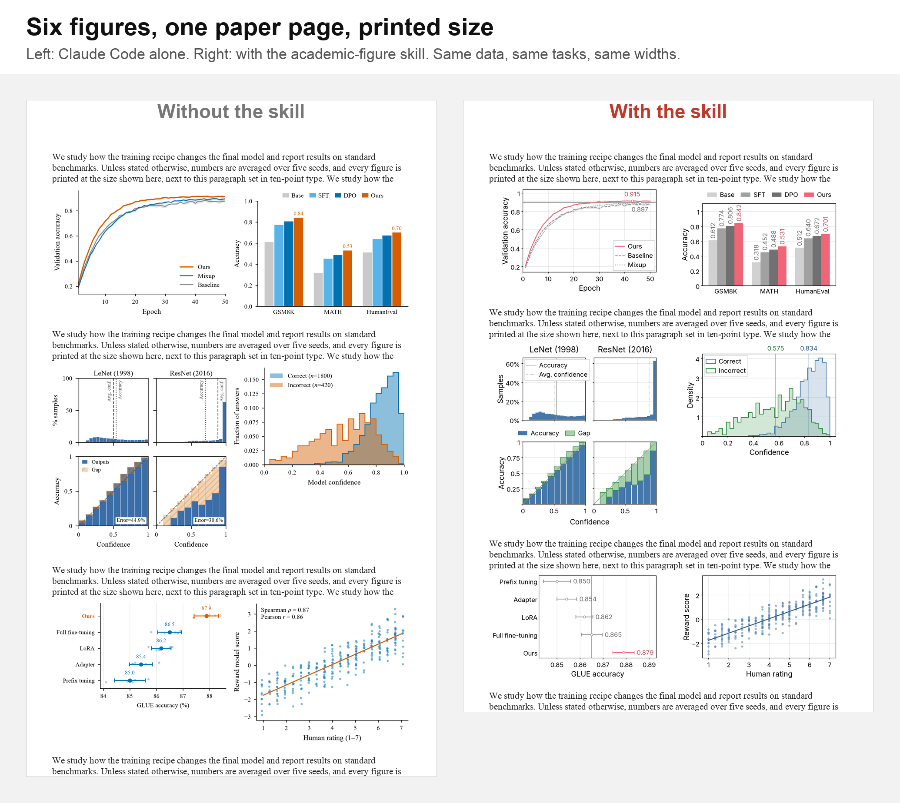
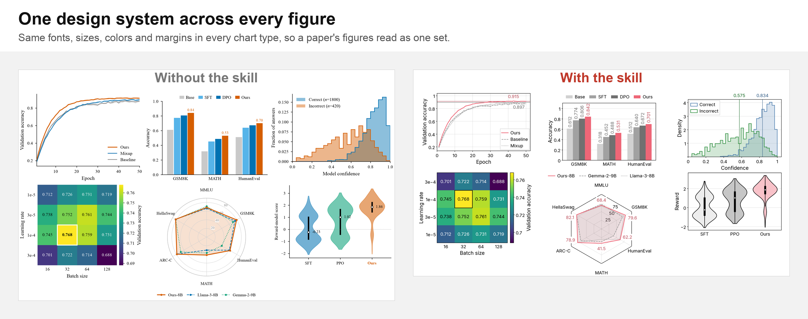
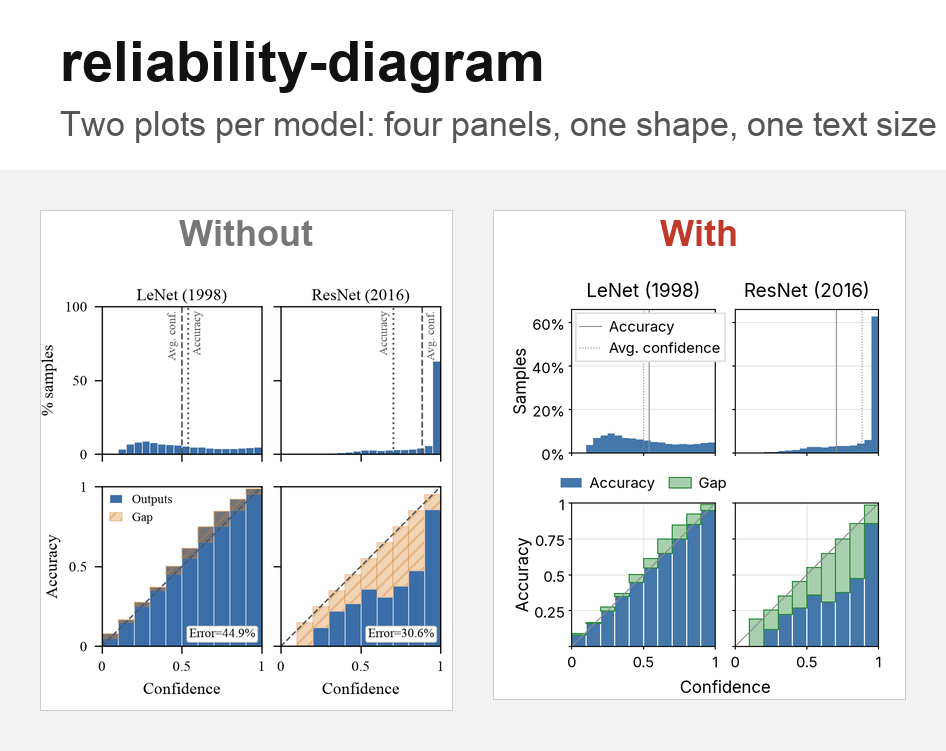
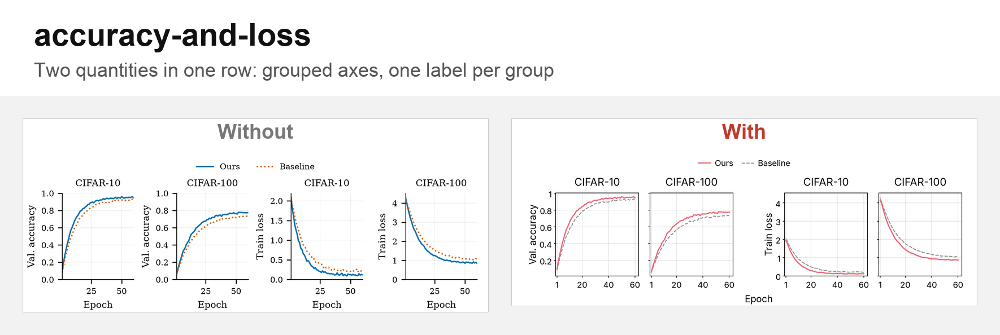
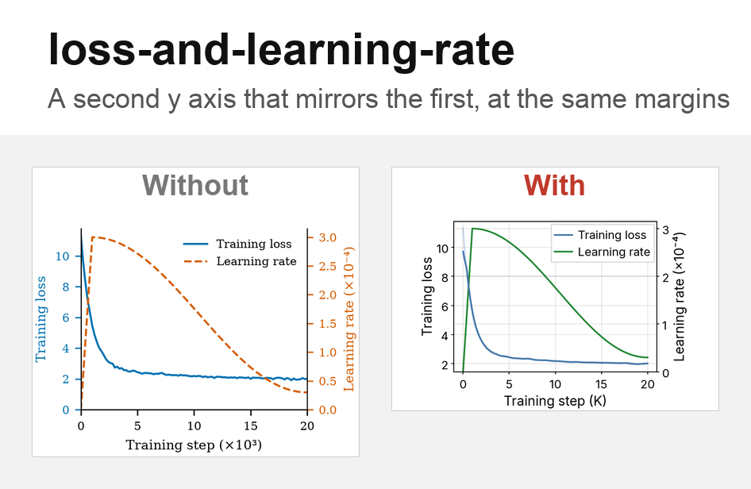
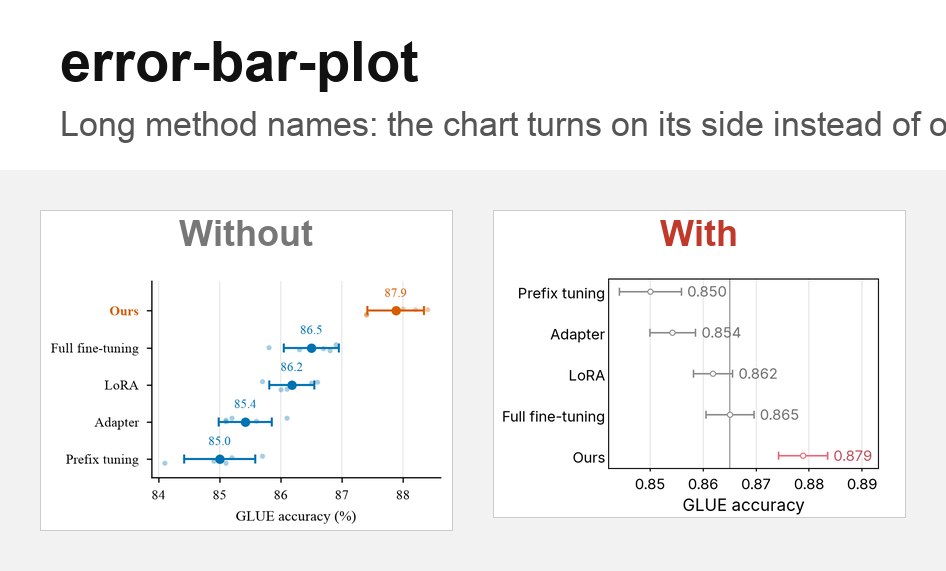
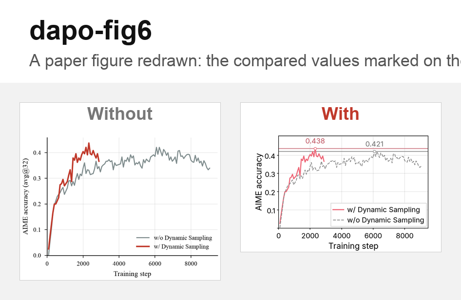

# Why academic-figure

Ask an AI coding agent for one plot and you get a decent plot. Ask it for the six plots of a paper and you get six plots that don't belong together: different fonts, different text sizes, different margins, colors that mean something in one figure and nothing in the next. Then you spend an evening making them match.

**academic-figure** is a Claude Code skill that gives the agent a design system, and checks its work, so every figure comes out publication-ready and the figures match each other.

Every image below was made the same way: the same data and the same task, given to fresh Claude Code sessions with no memory and no project instructions, once without the skill and once with it, at the same figure width. Nothing was edited by hand.

## 1. A paper page, not a single plot



Figures are judged where they end up: on a page, at print size, next to 10 pt body text.

- **Without the skill**, each figure is fine on its own, but the set isn't. Serif in one figure, sans-serif in the next. Tick labels from 5 pt to 8 pt. Every figure has a different height for the same width.
- **With the skill**, every figure uses the same type sizes (8 pt labels, 7 pt ticks), the same font, and the same margins. The six figures also take about an inch less of the page (6.1 in vs 7.1 in).

## 2. One design system for every chart type



Line charts, bars, histograms, heatmaps, radar charts and violins follow one set of rules:

- **Colors carry meaning.** Your method is one color, baselines are grey, and the color means the same thing in every figure. The palette is color-blind safe.
- **Numbers are exact.** The values the takeaway compares are written on the plot, in one number format.
- **Text sizes are tokens, not guesses.** They are set once in `DESIGN.md` and never changed per figure.

## 3. Sizes from a formula, not from luck

Figures in a paper should line up. The skill doesn't eyeball sizes. It computes them:

```
panel width  = (figure width − left margin − right margin − column gaps) / columns
panel height = aspect × panel width
```

The margins are fixed text measures: the left margin fits an axis label plus four-character tick labels, and the right margin fits half a tick label. As a result:

- Every half-width figure in the paper has the same panel box.
- Every figure's right edge lines up.
- A figure with long category names gets a narrower panel, never a taller one.



The reliability diagram above has four panels in one shape and text the same size as every other figure on the page.

## 4. Multi-panel layouts that stay regular

Real figures have grouped axes, shared labels and second y axes. The same formula covers them.



- **Grouped axes:** columns that share a quantity sit close together, groups stand apart, and each quantity is named once.



- **A second y axis** mirrors the first, with the same tick and label room. The panel narrows instead of the figure growing.

## 5. Tested, not judged

The agent doesn't decide "looks fine". After drawing, `fit_height` checks the figure and warns when:

- text overlaps, is cut off, or spills out of a bar or band;
- a legend or label covers a curve, data points or the end of a bar (which is its value);
- an axis label is longer than its panel, or a legend is wider than the figure;
- a panel is too narrow to read.

Each warning names its fix: rotate the labels, swap the axes, move the legend, or write less. The agent keeps fixing until the script runs clean.



Long method names don't overlap or get squeezed. The chart turns on its side, as the rule for text tick labels says.

Every number is computed in the script and checked with an `assert`, and the caption is written from what the script prints. Rerun the script and you get the same figure and a caption that is still true.



## Try it

In Claude Code:

```
/plugin marketplace add bigohofone/academic-figure-skill
/plugin install academic-figure@academic-figure-skill
```

Then ask Claude Code for a figure as usual: "plot the learning curves in `results.json` for my ICLR paper." Each figure comes as one script, `figures/<id>.py`, with its caption as the docstring.

All examples, with their data, tasks and scripts, are in [`examples/`](examples).

---

## Thread draft for X

1/
Ask an AI agent for one plot: fine.
Ask it for the 6 plots of a paper: 6 fonts, 6 text sizes, 6 different margins.

I built a Claude Code skill that makes paper figures look like one set, and checks its own work. 🧵
[image: page.png]

2/
Same data, same task, fresh sessions, same width.
Left: Claude Code alone. Right: with the skill.
At print size next to 10 pt text: one font, 8 pt labels, 7 pt ticks, about 1 inch less of the page.

3/
Sizes aren't eyeballed, they're computed:
panel width = (width − margins − gaps) / columns
So every half-width figure has the same panel box, and every right edge lines up.
[image: consistency.png]

4/
Grouped axes, shared labels, a second y axis: same formula, same margins.
[image: accuracy-and-loss.png]

5/
"Looks fine" isn't a test. After drawing, the agent gets warnings: overlapping text, a legend over data, a label longer than its panel. Each warning names its fix, and the agent fixes until the script runs clean.
[image: error-bar-plot.png]

6/
Every number is computed and asserted in the script, and the caption is written from its output.
Open source: github.com/bigohofone/academic-figure-skill
