# academic-figure: without / with the skill

The seven figures of [DAPO](https://arxiv.org/abs/2503.14476) (Yu et al., 2025), drawn twice from the same data ([`dapo.json`](academic-figure/dapo.json), read from the paper PDF's vector paths) and the same task ([`task.md`](academic-figure/task.md)), by two separate Claude Code subagents with clean contexts:

- **Without skill**: plain matplotlib, no skill loaded. Code: [`without-skill.py`](academic-figure/without-skill.py).
- **With skill**: following `academic-figure`. Code: [`with-skill.ipynb`](academic-figure/with-skill.ipynb).

Each figure is shown at its printed width (1 in = 96 px), so at 100% browser zoom it appears at roughly real size.

## Figure 1: AIME 2024 scores of DAPO

**Without skill**

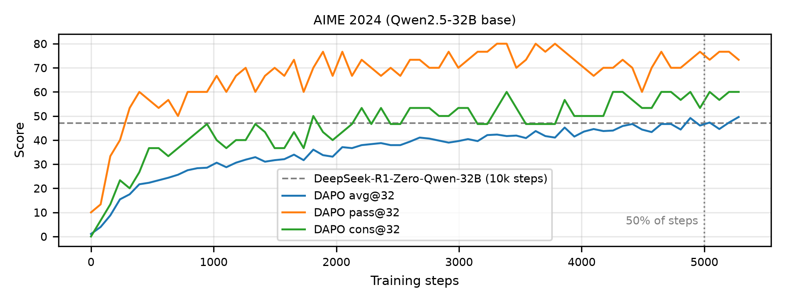

**With skill**

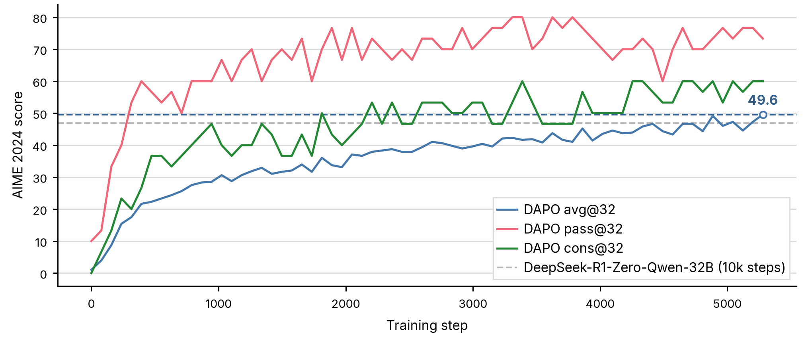

## Figure 2: Clip-Higher

**Without skill**

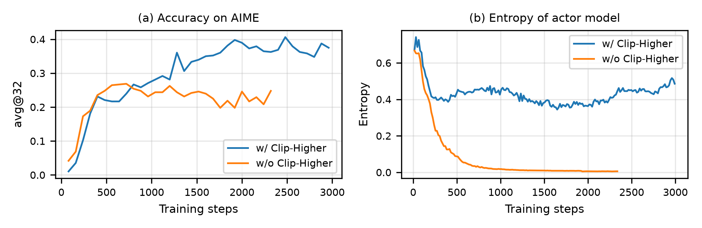

**With skill**

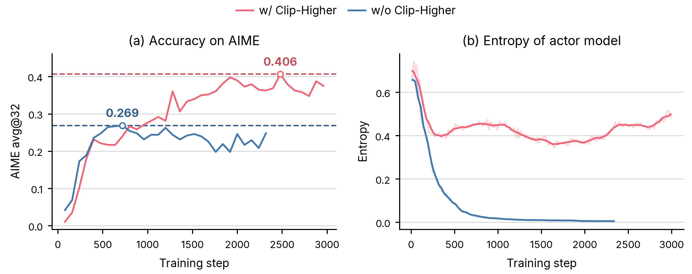

## Figure 3: Up-clipped probability and prompts with accuracy 1

**Without skill**

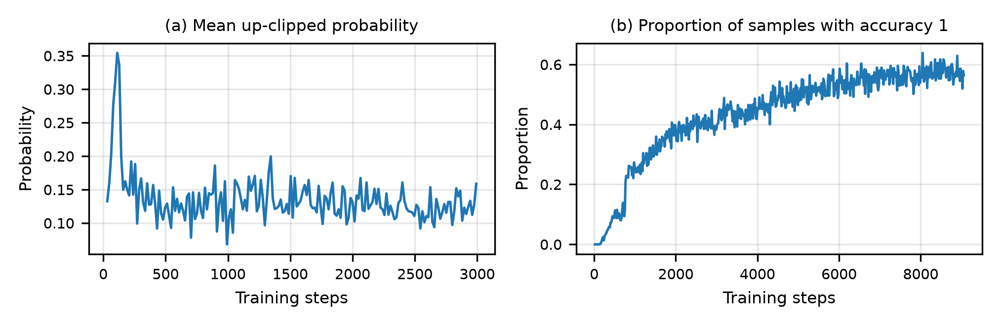

**With skill**

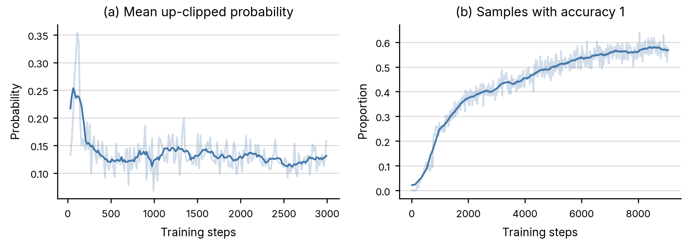

## Figure 4: Token-level policy gradient loss

**Without skill**

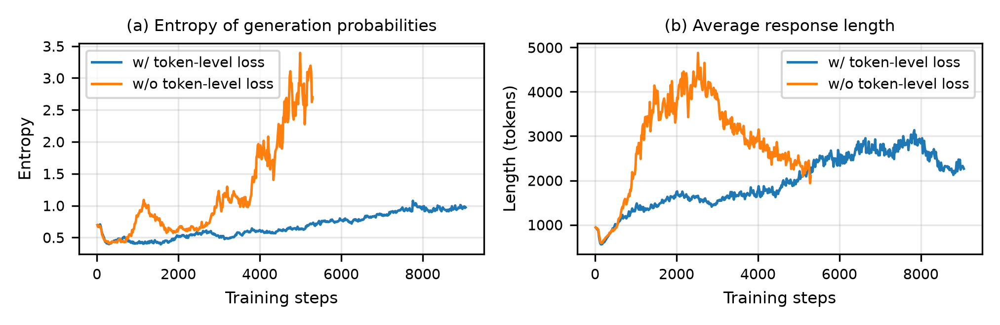

**With skill**

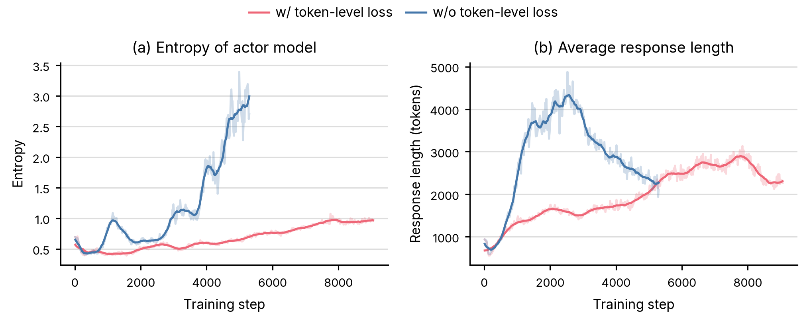

## Figure 5: Overlong filtering

**Without skill**

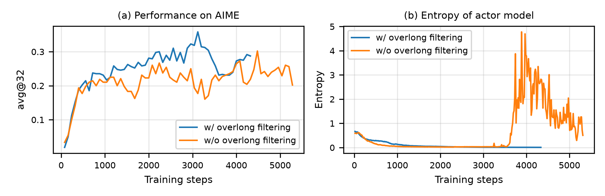

**With skill**

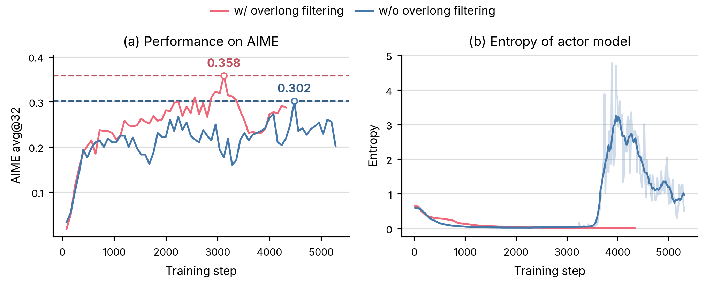

## Figure 6: Dynamic sampling (1.5 column)

**Without skill**

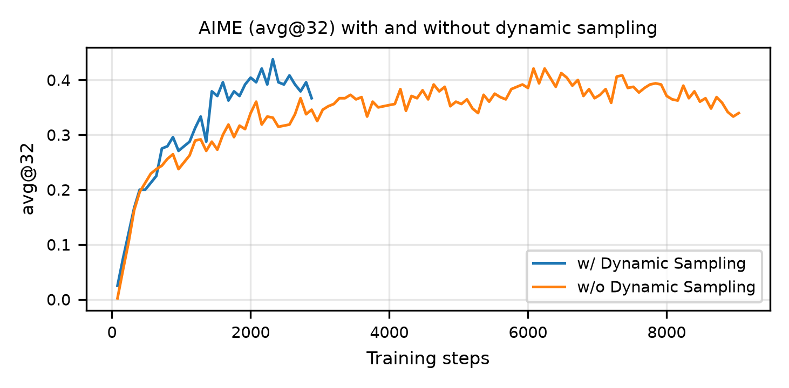

**With skill**

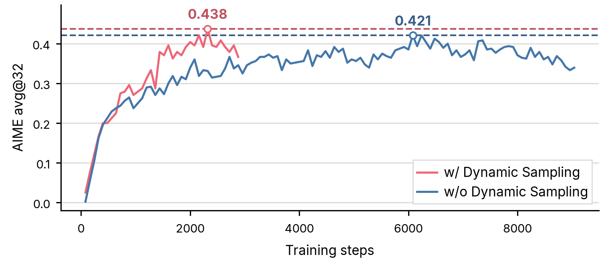

## Figure 7: Training dynamics of DAPO

**Without skill**

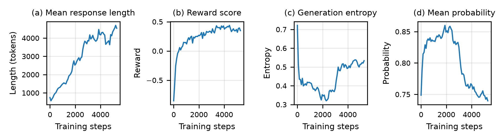

**With skill**

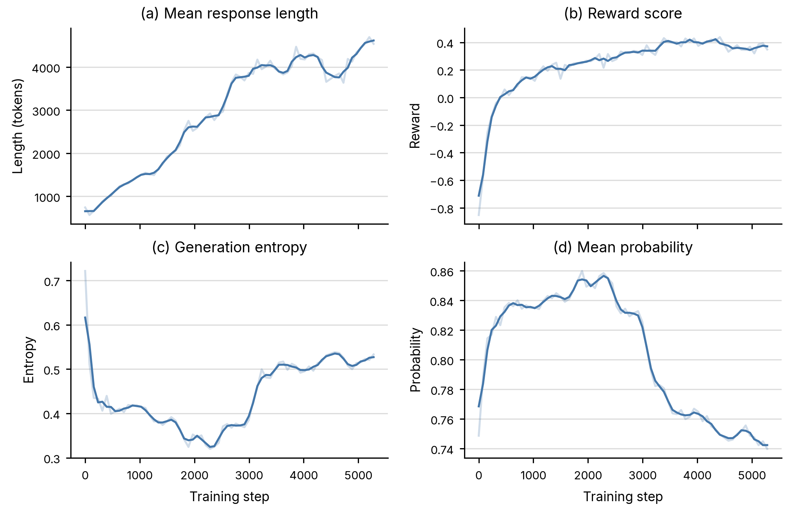
