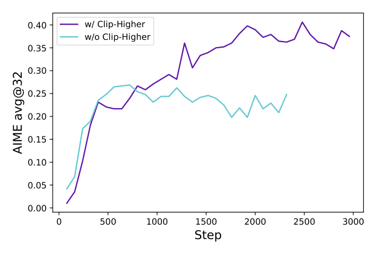
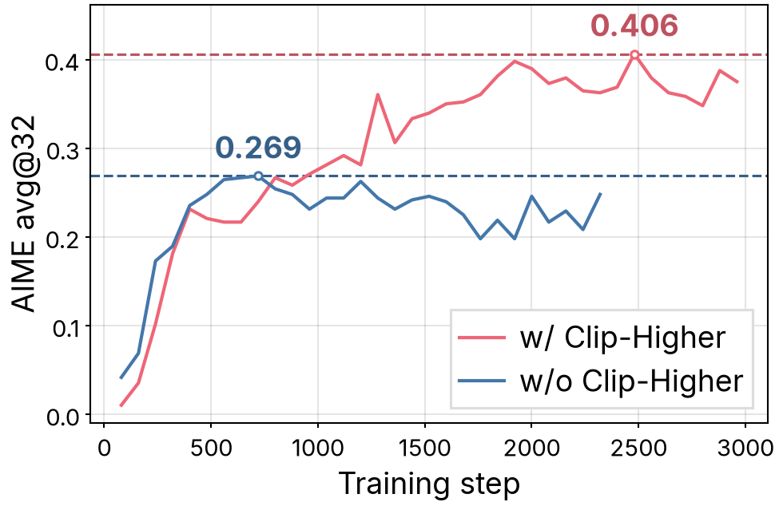
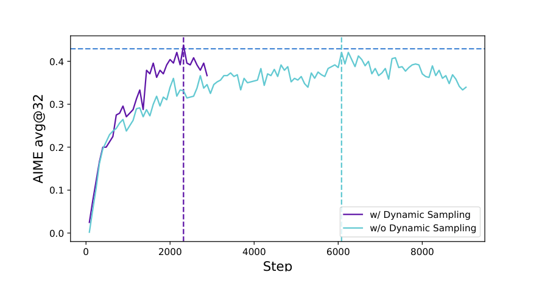
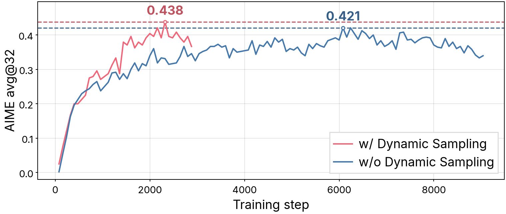
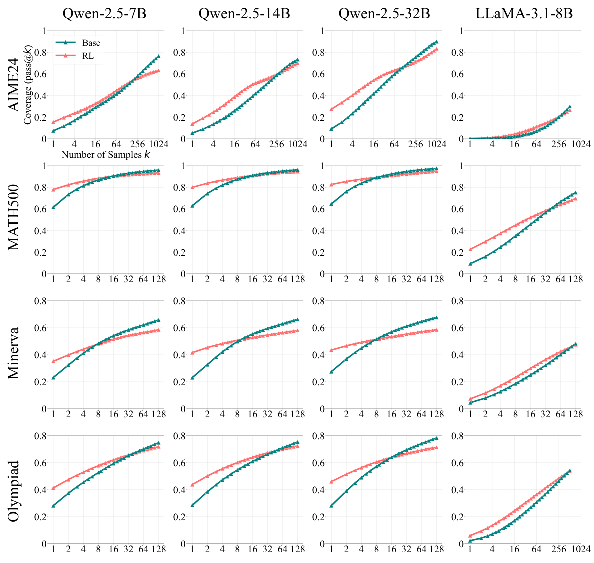
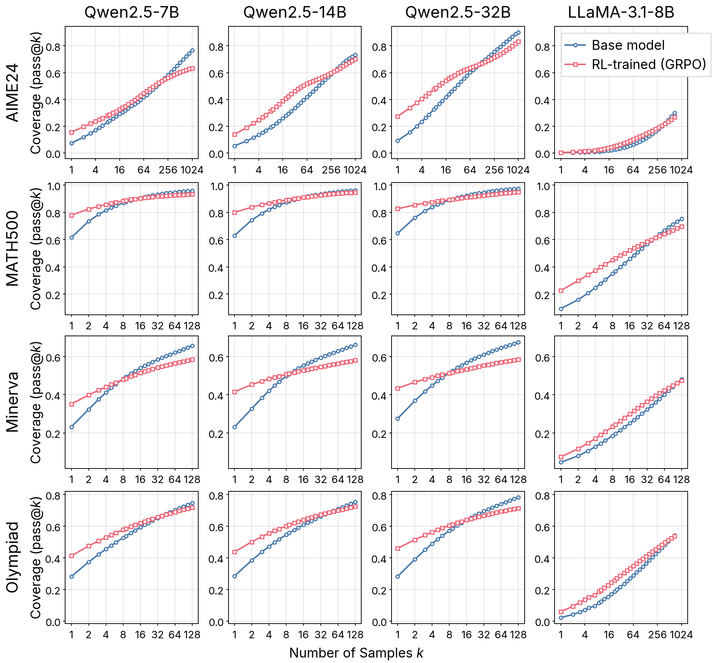
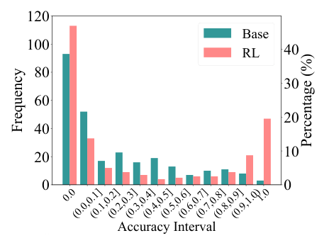
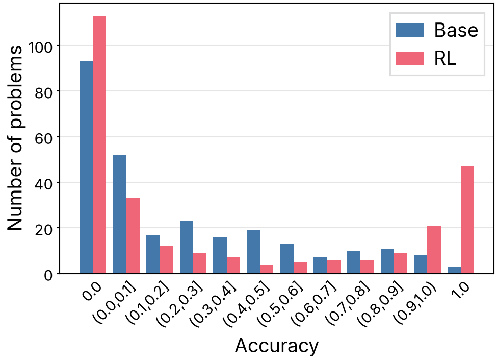
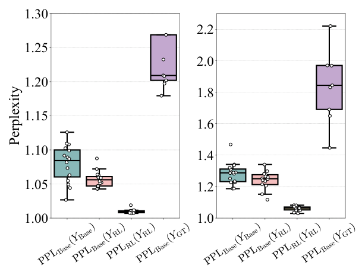
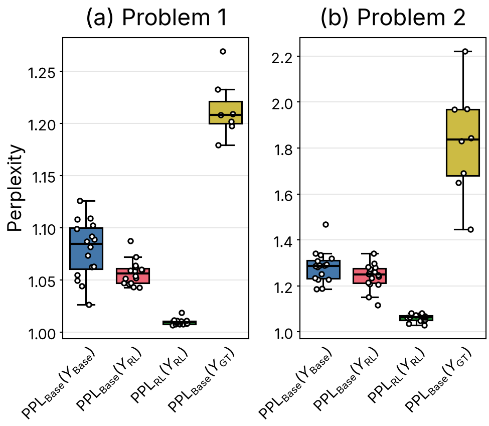

# academic-figure: original / with the skill

Figures from published papers, each shown as printed in the paper and as redrawn by a Claude Code subagent with a clean context following `academic-figure`. The subagent gets only the figure's data (read from the paper's vector paths) and a task file describing the figure.

Both versions of a figure are shown at the column width it is printed at (single column 3.25 in, 1.5 column 5.0625 in, double column 6.75 in; 1 in = 96 px), so at 100% browser zoom they appear at roughly real size.

## DAPO, Figure 2 (left panel, single column)

[DAPO: An Open-Source LLM Reinforcement Learning System at Scale](https://arxiv.org/abs/2503.14476) (Yu et al., 2025). Data: [`dapo.json`](academic-figure/dapo.json), task: [`dapo-task.md`](academic-figure/dapo-task.md), code: [`dapo-with-skill.ipynb`](academic-figure/dapo-with-skill.ipynb).

**Original**

**With skill**

## DAPO, Figure 6 (1.5 column)

[DAPO: An Open-Source LLM Reinforcement Learning System at Scale](https://arxiv.org/abs/2503.14476) (Yu et al., 2025). Same data, task and code as Figure 2.

**Original**

**With skill**

## Does RL Really Incentivize Reasoning Capacity?, Figure 2 (double column)

[Does Reinforcement Learning Really Incentivize Reasoning Capacity in LLMs Beyond the Base Model?](https://arxiv.org/abs/2504.13837) (Yue et al., 2025). Data: [`rlvr.json`](academic-figure/rlvr.json), task: [`rlvr-task.md`](academic-figure/rlvr-task.md), code: [`rlvr-with-skill.ipynb`](academic-figure/rlvr-with-skill.ipynb).

**Original**

**With skill**

Drawn 4 × 4 like the original, with row and column headers.

## Does RL Really Incentivize Reasoning Capacity?, Figure 5 (single column)

[Does Reinforcement Learning Really Incentivize Reasoning Capacity in LLMs Beyond the Base Model?](https://arxiv.org/abs/2504.13837) (Yue et al., 2025). Data: [`rlvr-fig5.json`](academic-figure/rlvr-fig5.json), task: [`rlvr-task.md`](academic-figure/rlvr-task.md), code: [`rlvr-with-skill.ipynb`](academic-figure/rlvr-with-skill.ipynb).

**Original**

**With skill**

## Does RL Really Incentivize Reasoning Capacity?, Figure 6 (single column)

[Does Reinforcement Learning Really Incentivize Reasoning Capacity in LLMs Beyond the Base Model?](https://arxiv.org/abs/2504.13837) (Yue et al., 2025). Data: [`rlvr-fig6.json`](academic-figure/rlvr-fig6.json), task: [`rlvr-task.md`](academic-figure/rlvr-task.md), code: [`rlvr-with-skill.ipynb`](academic-figure/rlvr-with-skill.ipynb).

**Original**

**With skill**

